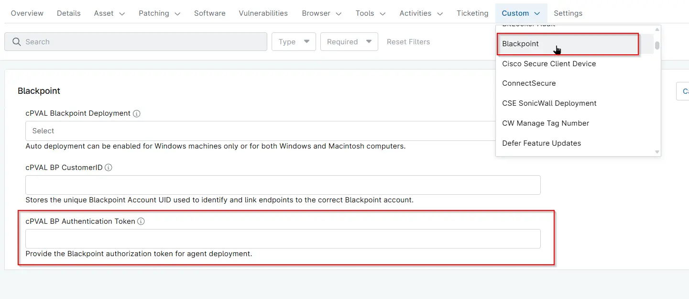

## Summary

Unique BlackPoint Authentication Code required to authenticate and install the BlackPoint Agent on endpoints.

## Details

| Label | Field Name | Definition Scope | Type | Required | Default Value | Editable |  Custom Field Tab Name |
| ----- | ---- | ---------------- | ---- | -------- | ------------- | --------------------- | --------------------- | 
| cPVAL BP Authentication Token | cpvalBpAuthenticationToken | `Device`, `organization`, `Location` | Multi-line | True | -- | Yes | BlackPoint |

## Dependencies

- [Automation - BlackPoint SnapAgent Installer - Windows](/docs/06b6d11b-92b0-478d-9323-3f599d5caa46)
- [Automation - BlackPoint SnapAgent Installer - MacOS](/docs/22a99cac-7acf-4251-a790-41a3b651f183)
- [Solution - BlackPoint SnapAgent Deployment](/docs/b9f13c4b-742d-4118-be8e-0c03e43ded17)

## Custom Field Creation

- [Custom Field Configuration](https://github.com/ProVal-Tech/ninjarmm/blob/main/custom-fields/cpval-bp-authentication-token.toml)

## Sample Screenshot

## Changelog

### 2026-11-06

- Renamed the custom field from `cPVAL BP Mac Auth Token` (`cpvalBpMacAuthToken`) to `cPVAL BP Authentication Token` (`cpvalBpAuthenticationToken`).
- Updated the summary and description. They now refer to BlackPoint Agent installation on endpoints instead of only macOS devices.
- Replaced the `cpval-bp-mac-auth-token.toml` custom field configuration with `cpval-bp-authentication-token.toml`.
- Added the `BlackPoint SnapAgent Installer - Windows` automation to the Dependencies. The Windows installer now reads this field too.
- Simplified the Details table. It now shows the `Editable` column instead of the Technician, Automation and API permission, Description, Tool Tip and Footer Text columns.

### 2025-11-28

- Initial version of the document
