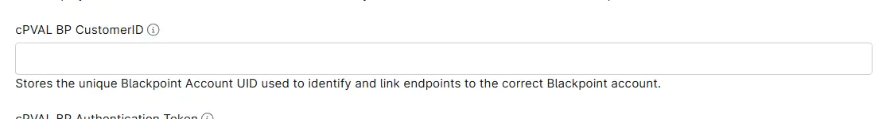

## Summary

This field stores the unique Blackpoint AccountUID, which is the identifier used by Blackpoint to associate endpoints and services with the correct customer account. It ensures accurate mapping and automation when deploying agents.

## Details

| Label | Field Name | Definition Scope | Type | Required | Default Value | Editable |  Custom Field Tab Name |
| ----- | ---- | ---------------- | ---- | -------- | ------------- | --------------------- | --------------------- | 
|cPVAL BP CustomerID | cpvalBpCustomerid | `Device`, `organization`, `Location` | Text | True | --  | Yes | BlackPoint |

## Dependencies

- [Automation - BlackPoint SNAP Installer - Windows](/docs/06b6d11b-92b0-478d-9323-3f599d5caa46)
- [Automation - BlackPoint SnapAgent Installer - MacOS](/docs/22a99cac-7acf-4251-a790-41a3b651f183)
- [Solution - BlackPoint SnapAgent Deployment](/docs/b9f13c4b-742d-4118-be8e-0c03e43ded17)

## Custom Field Creation

- [Custom Field Configuration](https://github.com/ProVal-Tech/ninjarmm/blob/main/custom-fields/cpval-bp-customerid.toml)

## Sample Screenshot

## Changelog

### 2026-11-04

- Renamed the custom field from `cPVAL BP AccountUID` (`cpvalbpaccountuid`) to `cPVAL BP CustomerID` (`cpvalBpCustomerid`).
- Replaced the `cpval-bp-account-uid.toml` custom field configuration with `cpval-bp-customerid.toml`.
- Updated the Dependencies. They now list the renamed `BlackPoint SNAP Installer - Windows` automation and add the `BlackPoint SnapAgent Installer - MacOS` automation, which also reads this field.
- Simplified the Details table. It now shows the `Editable` column instead of the Technician, Automation and API permission, Description, Tool Tip and Footer Text columns.

### 2025-11-28

- Initial version of the document
