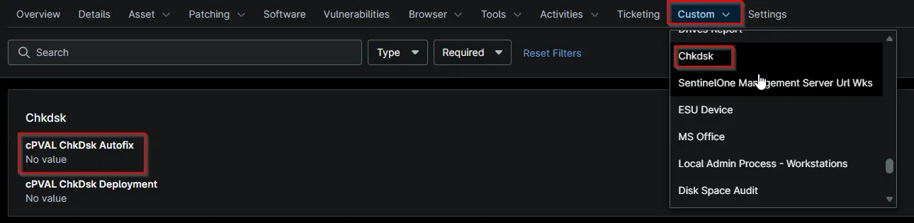

## Summary

## Details

| Label | Field Name | Example | Definition Scope | Type | Required | Default Value | Dropdown Options | Editable | Custom Field Tab |
| ----- | ---------- | ------- | ---------------- | ---- | -------- | ------------- | ---------------- | -------- | ---------------- |
| cPVAL ChkDsk Deployment | cpvalChkdskDeployment | -- | `Device, Organization, Location, System` | `DropDown` | `False` | -- | `Disabled`, `Windows Servers`, `windows Workstations` | True | chkdsk |

## Dependencies

* [Automation: CHKDSK - Run All Drives](/docs/b2cc4bdc-cbb4-46b7-a785-a7bbb9341b55)
* [Solution: CHKDSK All Drives - NinjaOne](/docs/d7759df0-48d0-45c4-a1ca-958fe849ad79)

## Custom Field Creation

- [Custom Field Configuration](https://github.com/ProVal-Tech/ninjarmm/blob/main/custom-fields/cpval-chkdsk-autofix.toml)

## Sample Screenshot

## Changelog

### 2026-10-19

- Initial version of the document
