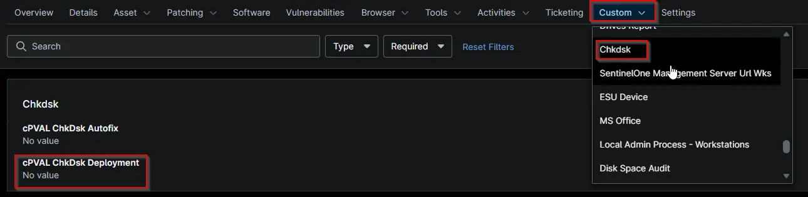

## Summary

This is used within the compound condition if CHKDSK automation needs to run or not.

## Details

| Label | Field Name | Example | Definition Scope | Type | Required | Default Value | Dropdown Options | Editable | Custom Field Tab |
| ----- | ---------- | ------- | ---------------- | ---- | -------- | ------------- | ---------------- | -------- | ---------------- |
| cPVAL ChkDsk Deployment | cpvalChkdskDeployment | -- | `Device, Organization, Location, System` | Dropdown | `False` | -- | `Disabled`, `Windows Servers` | True| chkdsk |

## Dependencies

* [Compound Condition:  cPVAL ChkDsk Autofix](/docs/5b3e6c68-6d0a-4b1f-b58a-eba8b870b9ad)
* [Solution: CHKDSK All Drives - NinjaOne](/docs/d7759df0-48d0-45c4-a1ca-958fe849ad79)

## Custom Field Creation

- [Custom Field Configuration](https://github.com/ProVal-Tech/ninjarmm/blob/main/custom-fields/cpval-chkdsk-deployment.toml)

## Sample Screenshot

## Changelog

### 2026-10-16

- Initial version of the document
