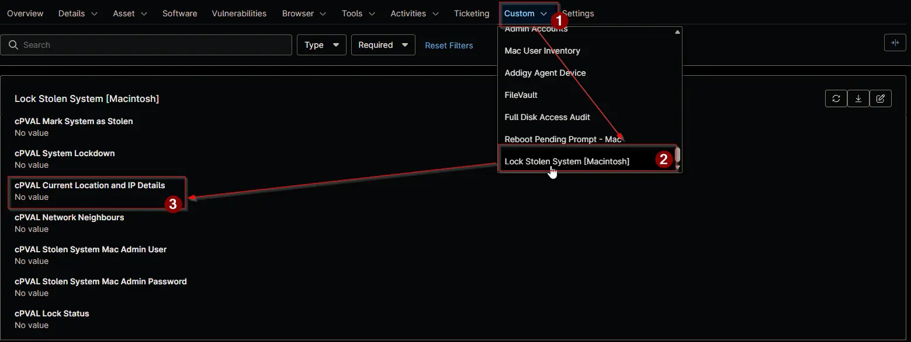

## Summary

Shows where a stolen device connects from. The [Lock Stolen System](/docs/13b4df99-df9b-4a57-bc0f-8675c68be028) solution fills it in each time the device is online with the collection time (UTC), the disk encryption status (BitLocker on Windows, FileVault on a Mac), and the public IP address, internet provider, city, region, country and coordinates from ipinfo.io. Windows computers add their full network configuration. Macs add the Wi-Fi network name, default gateway, DNS servers and active network interfaces. The location comes from the IP address, so it's approximate. The field is on the **Lock Stolen System [Windows]** tab of Windows devices and the **Lock Stolen System [Macintosh]** tab of Macs.

## Details

| Label | Field Name | Example | Definition Scope | Type | Required | Default Value | Dropdown Options | Editable | Custom Field Tab |
| ----- | ---------- | ------- | ---------------- | ---- | -------- | ------------- | ---------------- | -------- | ---------------- |
| cPVAL Current Location and IP Details | cpvalCurrentLocationAndIpDetails | `IPINFO-City= Austin` | `Device` | Multi-line | No |  | | Yes | <ul><li>`Lock Stolen System [Windows]`</li><li>`Lock Stolen System [Macintosh]`</li></ul> |

## Dependencies

- [Automation: Lock Stolen System [Windows]](/docs/0f78be64-557a-4c0e-b7cf-e2ba41e71374)
- [Automation: Lock Stolen System [Macintosh]](/docs/08b38e83-0836-49de-b185-dbfc97a0f249)
- [Solution: Lock Stolen System](/docs/13b4df99-df9b-4a57-bc0f-8675c68be028)

## Custom Field Creation

- [Custom Field Configuration](https://github.com/ProVal-Tech/ninjarmm/blob/main/custom-fields/cpval-current-location-and-ip-details.toml)

## Sample Screenshot

## Changelog

### 2026-11-12

- Added the field to Mac devices on the Lock Stolen System [Macintosh] tab and moved it to the Lock Stolen System [Windows] tab on Windows devices. It now also shows the collection time, internet provider, country and disk encryption status, and Macs report their Wi-Fi network name, gateway, DNS servers and active network interfaces.

### 2026-02-10

- Initial version of the document
