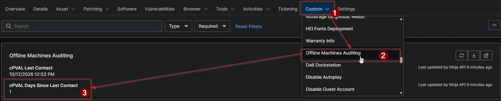

## Summary

Stores the whole number of days elapsed since a device last contacted NinjaOne when its offline duration meets or exceeds the lowest threshold supplied to the [Offline Machines Report - Organization and Global KB](/docs/bae00191-7c86-4ceb-96a9-f34f05b5ec9f) automation.

Paired with [cPVAL Last Contact](/docs/a47f9e12-6b3c-4d8a-9c21-7e508f3b19d4), this field enables device-level filtering, saved search groups, and policy conditions based on how many days an endpoint has been offline — providing full offline machine auditing even in NinjaOne environments where the paid Documentation (Knowledge Base) feature is not configured.

The value is calculated and written through the NinjaOne Public API on every run of the reporting automation. Every reported workstation or server whose last contact is at least as old as the lowest value in `Threshold Days` receives its current whole-day offline count in this field. When a device comes back online or falls below the lowest configured threshold on a subsequent run, the automation clears the value back to `null`.

## Details

| Label | Field Name | Example | Definition Scope | Type | Required | Default Value | Editable | Custom Field Tab |
| ----- | ---------- | ------- | ---------------- | ---- | -------- | ------------- | -------- | ---------------- |
| `cPVAL Days Since Last Contact` | `cpvalDaysSinceLastContact` | `45` | `Device` | `Integer` | `No` | | `No` | `Offline Machines Auditing` |

## Dependencies

- [Custom Field: cPVAL Last Contact](/docs/a47f9e12-6b3c-4d8a-9c21-7e508f3b19d4)
- [Custom Field: cPVAL Ninja API Client ID](/docs/32142af2-d352-4d0d-9ec3-9dae0a5fef88)
- [Custom Field: cPVAL Ninja API Client Secret](/docs/58b01634-4e1a-4793-aafd-18526ea8c80e)
- [Automation: Offline Machines Report - Organization and Global KB](/docs/bae00191-7c86-4ceb-96a9-f34f05b5ec9f)
- [Solution: Offline Machines Reporting](/docs/ec53fd65-8cd1-4af6-9f78-b3fa97e54af1)

## Custom Field Creation

- [Custom Field Configuration](https://github.com/ProVal-Tech/ninjarmm/blob/main/custom-fields/cpval-days-since-last-contact.toml)

## Sample Screenshot

## Changelog

### 2026-10-14

- Initial version of the document
