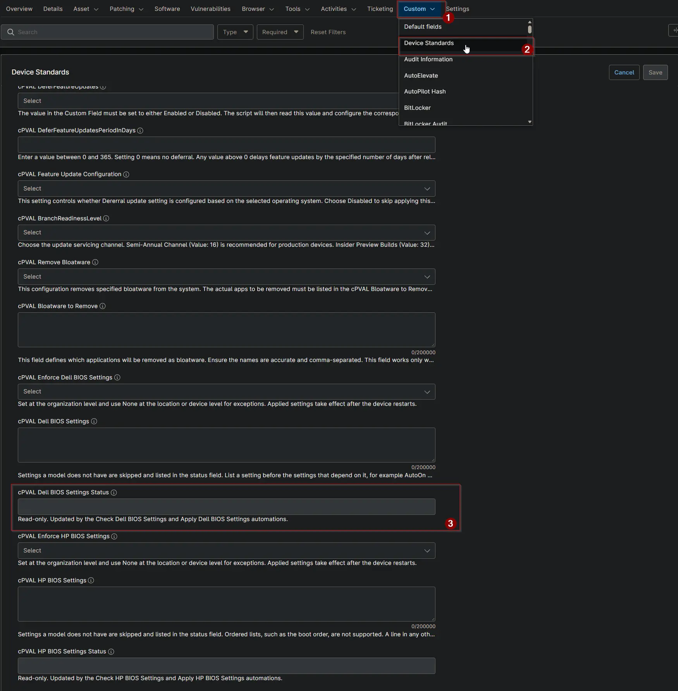

## Summary

This custom field shows the result of the [Enforce Dell BIOS Settings](/docs/d3ee4598-13c1-4d19-8b6c-d368f2a00ab3) solution on a device. It is updated by the [Check Dell BIOS Settings](/docs/a9117300-d45b-45e8-9cfe-e85859b1931b) and [Apply Dell BIOS Settings](/docs/b0c846eb-72d8-48ea-84b5-af87a02aa955) automations and is read-only for technicians.

## Details

| Label | Field Name | Example | Definition Scope | Type | Required | Default Value | Dropdown Options | Editable | Custom Field Tab |
| ----- | ---------- | ------- | ---------------- | ---- | -------- | ------------- | ---------------- | -------- | ---------------- |
| cPVAL Dell BIOS Settings Status | cpvalDellBiosSettingsStatus | Compliant | Device | Text | False | | | No | Device Standards |

## Status Values

Each value shows the status, the date and time it was first recorded, and details when there are any.

```PlainText
Compliant | 2026-10-16 21:05:12
Compliant | 2026-10-16 21:05:12 | Not supported: WakeOnDock
Non-Compliant | 2026-10-16 21:05:12 | Mismatch: AutoOn, AutoOnHr
Applied - Reboot Pending | 2026-10-16 21:05:12 | Changed: AutoOn, AutoOnHr
Failed | 2026-10-16 21:05:12 | Exit code 65: Setup Password is required to change the setting.
```

| Status | Meaning | Action |
| ------ | ------- | ------ |
| Compliant | Every supported setting matches. Not supported lists the settings this model does not have. | None. |
| Non-Compliant | At least one setting differs. Shown in Audit mode only. | Review the settings, then switch [cPVAL Enforce Dell BIOS Settings](/docs/eb1c5a88-0933-45e4-96e7-f71422e4ddba) to Enforce. |
| Applied - Reboot Pending | The settings were changed and take effect after a restart. The device is not checked again until it restarts. | Restart the device. |
| Failed | The settings could not be read or applied. The reason follows the date. | Fix the reason, for example the format of [cPVAL Dell BIOS Settings](/docs/0ca65a80-d1c0-4ef9-b078-cd3e8d9d89db). |

Use this field to build device groups, for example devices whose status contains Reboot Pending or Failed.

## Dependencies

- [Solution: Enforce Dell BIOS Settings](/docs/d3ee4598-13c1-4d19-8b6c-d368f2a00ab3)
- [Solution: Device Standards](/docs/a0c383d4-699a-4bb8-af7f-c2a007747182)
- [Script: Check Dell BIOS Settings](/docs/a9117300-d45b-45e8-9cfe-e85859b1931b)
- [Script: Apply Dell BIOS Settings](/docs/b0c846eb-72d8-48ea-84b5-af87a02aa955)

## Custom Field Creation

- [Custom Field Configuration](https://github.com/ProVal-Tech/ninjarmm/blob/main/custom-fields/cpval-dell-bios-settings-status.toml)

## Sample Screenshot



## Changelog

### 2026-10-16

- Initial version of the document
