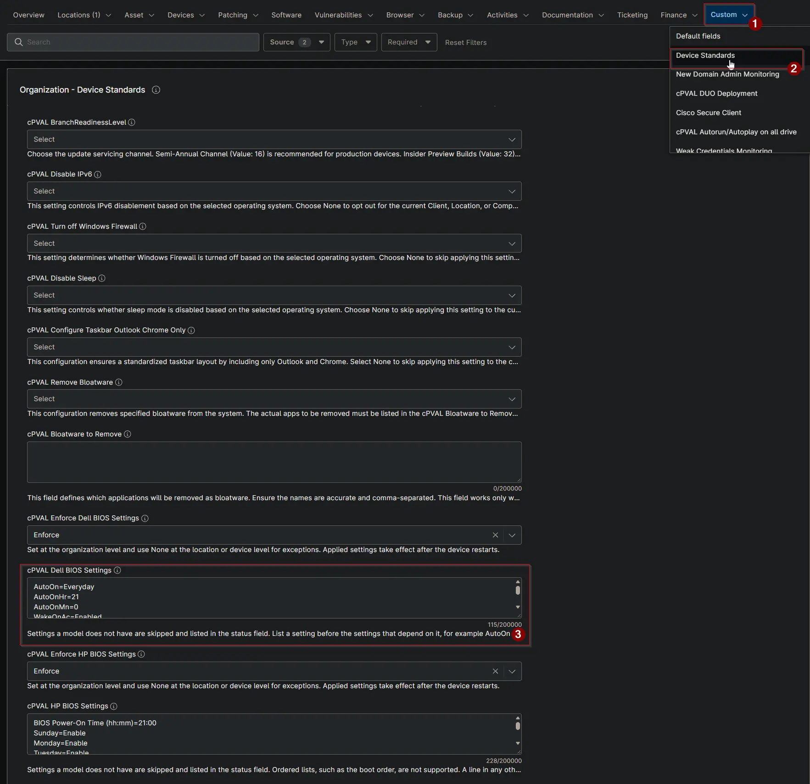

## Summary

This custom field stores the Dell BIOS settings that devices should have. The [Check Dell BIOS Settings](/docs/a9117300-d45b-45e8-9cfe-e85859b1931b) and [Apply Dell BIOS Settings](/docs/b0c846eb-72d8-48ea-84b5-af87a02aa955) automations compare the device with these settings.

## Details

| Label | Field Name | Example | Definition Scope | Type | Required | Default Value | Dropdown Options | Editable | Custom Field Tab |
| ----- | ---------- | ------- | ---------------- | ---- | -------- | ------------- | ---------------- | -------- | ---------------- |
| cPVAL Dell BIOS Settings | cpvalDellBiosSettings | `AutoOnHr=21` | Organization, Location, Device | Multi-line | False | | | Yes | Device Standards |

## Format

Enter one setting per line in the form `Option=Value`.

- Use the Dell Command | Configure option name without the leading dashes, for example `AutoOn`, not `--AutoOn`.
- Do not use spaces, and list each option only once.
- List a setting before the settings that depend on it, for example `AutoOn` before `AutoOnHr` and `AutoOnMn`.
- Times use the device's local time and a 24-hour clock, so `AutoOnHr=21` is 9 PM.

If any line does not follow this format, the solution stops and [cPVAL Dell BIOS Settings Status](/docs/1ddc8f49-ede2-4d44-871e-b448e8ba61ba) shows Failed with the line number.

**Example:** power on every day at 9 PM and allow Wake on LAN, Wake on AC and Wake on Dock.

```PlainText
AutoOn=Everyday
AutoOnHr=21
AutoOnMn=0
WakeOnAc=Enabled
WakeOnDock=Enabled
WakeOnLan=LanOnly
DeepSleepCtrl=Disabled
```

`DeepSleepCtrl=Disabled` lets models with Deep Sleep Control wake from a powered-off state. Settings that a model does not have, such as `WakeOnDock` on many desktops, are skipped and listed in the status field.

**Finding option names and values:** see the [Dell Command | Configure BIOS options reference](https://www.dell.com/support/manuals/en-us/command-configure-v4.2/dcc_cli_4.2/bios-options?guid=guid-44c059be-b76d-4b2f-b8ef-655f736c40ce&lang=en-us). To see a setting's current value on a device, run the [Dell Command | Configure](/docs/af7ff7d0-f398-462a-a896-9ae24920f151) automation with the option name, for example `--WakeOnLan`.

## Dependencies

- [Solution: Enforce Dell BIOS Settings](/docs/d3ee4598-13c1-4d19-8b6c-d368f2a00ab3)
- [Solution: Device Standards](/docs/a0c383d4-699a-4bb8-af7f-c2a007747182)
- [Script: Check Dell BIOS Settings](/docs/a9117300-d45b-45e8-9cfe-e85859b1931b)
- [Script: Apply Dell BIOS Settings](/docs/b0c846eb-72d8-48ea-84b5-af87a02aa955)

## Custom Field Creation

- [Custom Field Configuration](https://github.com/ProVal-Tech/ninjarmm/blob/main/custom-fields/cpval-dell-bios-settings.toml)

## Sample Screenshot



## Changelog

### 2026-10-16

- Initial version of the document
