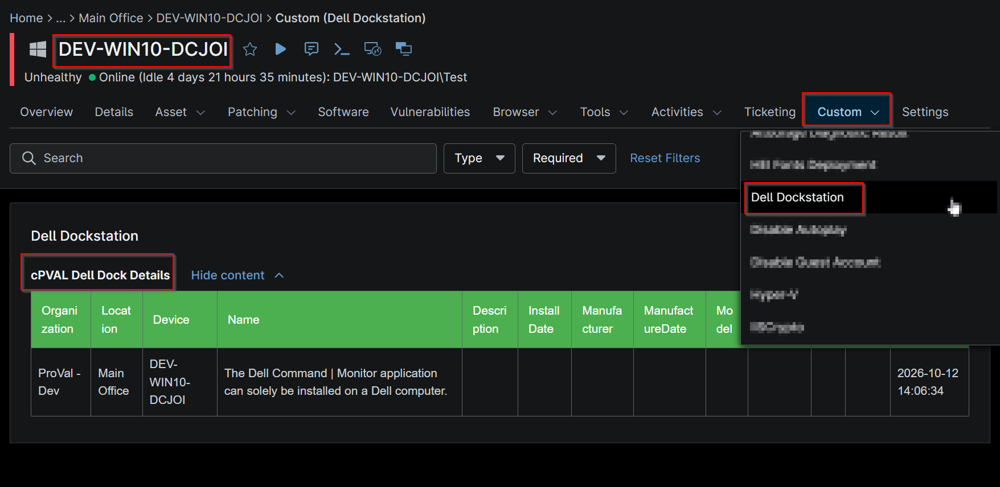

## Summary

This custom field stores the information of the Dell dockstation fetched by the script [Get Dell Dockstation](/docs/bdf95bc2-1b42-4436-a2f8-f2aca13678c4).

## Details

| Label | Field Name | Example | Definition Scope | Type | Required | Default Value | Dropdown Options | Editable | Custom Field Tab |
| ----- | ---------- | ------- | ---------------- | ---- | -------- | ------------- | ---------------- | -------- | ---------------- |
| cPVAL Dell Dock Details | cpvalDellDockDetails | Tabular Data | `Device` | WYSIWYG | true |  |  | Yes | Dell Dockstation |

## Table Columns

| Column Name | Description |
|-------------|-------------|
| Organization | The organization to which the device is assigned. |
| Location | The location associated with the device. |
| Device | The name of the device where the Dell Docking Station was detected. |
| Name | The name of the detected Dell Docking Station connected to the device. |
| Description | A description of the Dell Docking Station, including available hardware details. |
| InstallDate | The date when the Dell Docking Station driver, software, or related components were installed on the device. |
| Manufacturer | The manufacturer of the docking station, typically Dell Technologies. |
| ManufacturerDate | The manufacturing date of the Dell Docking Station, as reported by the device firmware or hardware inventory. |
| Model | The model identifier of the Dell Docking Station. |
| SerialNumber | The unique serial number assigned to the Dell Docking Station. |
| Tag | The asset tag or service tag associated with the Dell Docking Station. |
| Version | The firmware, hardware, or software version detected for the Dell Docking Station. |
| ScriptLastRunTime | The date and time when the [Script - Get Dell Dockstation](/docs/bdf95bc2-1b42-4436-a2f8-f2aca13678c4) last g station information. |

## Dependencies

[Solution - Get Dell Dockstation](/docs/8a8440f2-4451-4aa5-ada1-1187a22b26a4)

## Custom Field Creation

- [Custom Field Configuration](https://github.com/ProVal-Tech/ninjarmm/blob/main/custom-fields/cpval-dell-dock-details.toml)

## Sample Screenshot

## Changelog

### 2026-10-22

- Initial version of the document