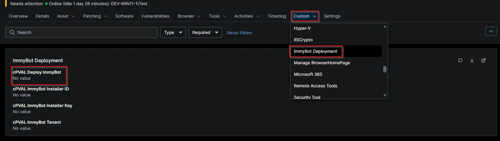

## Summary

This custom field is used under the compound condition to perform the Immybot deployment.

## Details

| Label | Field Name | Example | Definition Scope | Type | Required | Default Value | Dropdown Options | Editable | Custom Field Tab |
| ----- | ---------- | ------- | ---------------- | ---- | -------- | ------------- | ---------------- | -------- | ---------------- |
| cPVAL ImmyBot Tenant | cpvalImmybotTenant | -- | `Device`, `Location`, `Organization`, `System` | `DropDown` | -- | -- | `Windows Workstations and Servers`, `Windows Workstations`, `Windows Servers`, `None` | `Yes` | `ImmyBot Deployment` |

## Dependencies

[Solution - Immybot Agent Deployment - NinjaOne](/docs/72284ce2-4cf0-402b-99c3-7c0cafa3d213)
[Script - Install ImmyBot Agent](/docs/72284ce2-4cf0-402b-99c3-7c0cafa3d213)

## Custom Field Creation

- [Custom Field Configuration](https://github.com/ProVal-Tech/ninjarmm/blob/main/custom-fields/cpval-deploy-immybot.toml)

## Sample Screenshot

## Changelog

### 2026-10-14

- This is initial version of the document.
