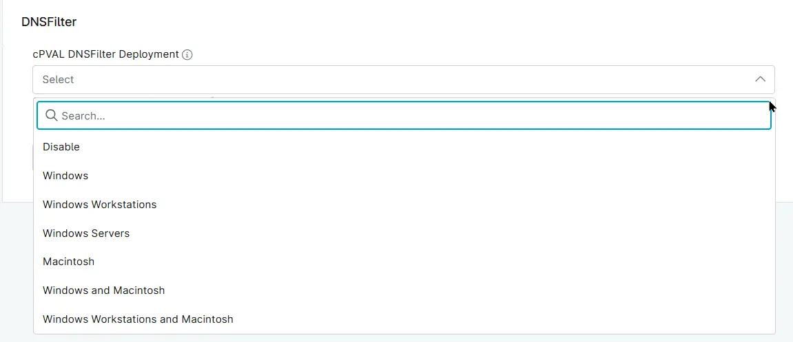

## Summary
Custom Field to select the target operating system for DNSFilter Agent deployment.

## Details

| Label | Field Name | Example | Definition Scope | Type | Required | Default Value | Dropdown Options | Editable | Custom Field Tab |
| ----- | ---------- | ------- | ---------------- | ---- | -------- | ------------- | ---------------- | -------- | ---------------- |
| cPVAL DNSFilter Deployment | cpvalDnsfilterDeployment | - | `Device`, `organization`, `Location` | Drop-Down | `False` | - | `Disable`, `Windows`, `Windows Workstations`, `Windows Servers`, `Macintosh`, `Windows and Macintosh`, `Windows Workstations and Macintosh` | DNSFilter | 

## Dependencies

* [Solution - DNSFilter Deployment](/docs/1c257867-5a6f-4887-a383-7c5af4cf1c98)

## Custom Field Creation

- [Custom Field Configuration](https://github.com/ProVal-Tech/ninjarmm/blob/main/custom-fields/cpval-dns-filter-deployment.toml)

## Sample Screenshot

## Changelog

### 2026-10-29

- Initial version of the document

