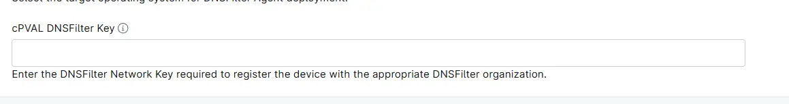

## Summary

Custom Field to enter the DNSFilter Network Key required to register the device with the appropriate DNSFilter organization. This key is required for deploying the DNSFilter Agent.

## Details

| Label | Field Name | Example | Definition Scope | Type | Required | Default Value | Editable | Custom Field Tab |
| ----- | ---------- | ---------------- | ---- | --------- | --------------------- | --------------------- | -------------- | ----- |
| cPVAL DNSFilter Key | cpvaldnsfilterkey | | `Device`, `Location`, `Organization` | Text | False | | True | DNSFilter |

## Dependencies

* [Solution - DNSFilter Deployment](/docs/1c257867-5a6f-4887-a383-7c5af4cf1c98)

## Custom Field Creation

- [Custom Field Configuration](https://github.com/ProVal-Tech/ninjarmm/blob/main/custom-fields/cpval-dns-filter-key.toml)

## Sample Screenshot

## Changelog

### 2026-10-29

- Updated the documents as per Proval's new Standard

### 2025-07-17

- Initial version of the document
