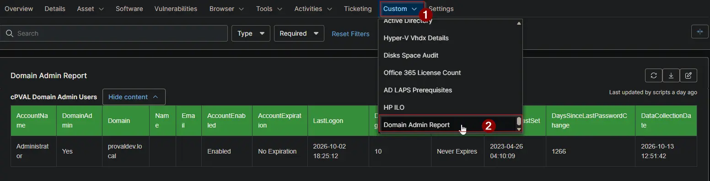

## Summary

Lists every user account with Domain Admin rights, including accounts that get the rights through nested groups. Use it to review who can administer the domain and to spot stale or unused admin accounts. The [Active Directory - Users with Domain Admin Audit](/docs/f990a8c2-84fe-4f1a-8687-dcc412dfd520) automation fills this field, and the [Active Directory - Users With Domain Admin](/docs/630beb69-029d-4103-8fd0-f5d3f3311bfc) report collects it from every client.

:::note  
Only the primary domain controller fills this field. It stays empty on every other device.  
:::

## Details

| Label | Field Name | Example | Definition Scope | Type | Required | Default Value | Dropdown Options | Editable | Custom Field Tab |
| ----- | ---------- | ------- | ---------------- | ---- | -------- | ------------- | ---------------- | -------- | ---------------- |
| cPVAL Domain Admin Users | cpvalDomainAdminUsers | HTML table | `Device` | `WYSIWYG` | `False` | - | - | `Yes` | Domain Admin Report |

## Table Columns

The field holds a table with one row per account.

| Column | Description |
| ------ | ----------- |
| AccountName | The sign-in name of the account. |
| DomainAdmin | Always `Yes`. Every listed account has Domain Admin rights. |
| Domain | The name of the Active Directory domain. |
| Name | The display name of the account. Blank when not set. |
| Email | The email address of the account. Blank when not set. |
| AccountEnabled | `Enabled` or `Disabled`. |
| AccountExpiration | The date the account expires, or `No Expiration`. |
| LastLogon | The most recent sign-in, or `Never`. It can trail the real sign-in by up to 14 days when another domain controller handled it. |
| DaysSinceLastLogon | Days since the last sign-in. Blank when the account never signed in. |
| PasswordExpires | `Never Expires`, `Must Change at Next Logon`, `Expires: <date>` or `Expired: <date>`. |
| PasswordLastSet | The date the password was last changed, or `Never`. |
| DaysSinceLastPasswordChange | Days since the password was last changed. Blank when it was never set. |
| DataCollectionDate | When the data was collected. |

## Dependencies

* [Automation: Active Directory - Users with Domain Admin Audit](/docs/f990a8c2-84fe-4f1a-8687-dcc412dfd520)
* [Audit Report: Active Directory - Users With Domain Admin](/docs/630beb69-029d-4103-8fd0-f5d3f3311bfc)
* [Solution: Active Directory - Users with Domain Admin Audit](/docs/66340c96-0b27-472f-add9-609e38df48c1)

## Custom Field Creation

- [Custom Field Configuration](https://github.com/ProVal-Tech/ninjarmm/blob/main/custom-fields/cpval-domain-admin-users.toml)

## Sample Screenshot

## Changelog

### 2026-10-14

- Initial version of the document
