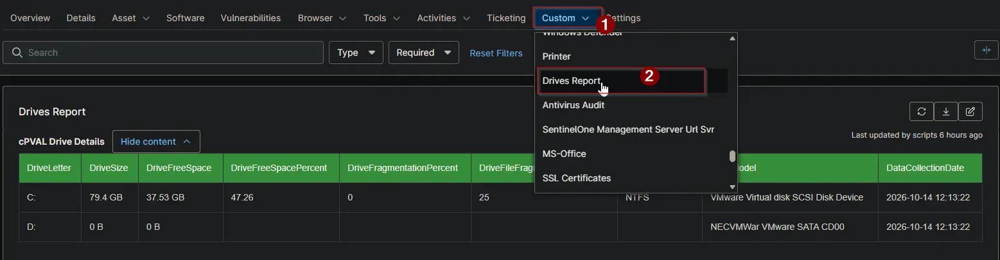

## Summary

Lists every drive on the device with its size, free space, fragmentation, file system and model. Use it to find drives that are running out of space or need attention. The [All Drives Audit [Windows]](/docs/2551b645-2fe7-47d2-9c24-41c79c1f7c35) automation fills this field, and the [All Drives Audit [Windows]](/docs/67c68be0-7c35-473f-8479-459d0e9b9406) report collects it from every client.

## Details

| Label | Field Name | Example | Definition Scope | Type | Required | Default Value | Dropdown Options | Editable | Custom Field Tab |
| ----- | ---------- | ------- | ---------------- | ---- | -------- | ------------- | ---------------- | -------- | ---------------- |
| cPVAL Drive Details | cpvalDriveDetails | HTML table | `Device` | `WYSIWYG` | `False` | - | - | `Yes` | Drives Report |

## Table Columns

The field holds a table with one row per drive.

| Column | Description |
| ------ | ----------- |
| DriveLetter | The drive letter, for example `C:`. |
| DriveSize | The total size in the largest fitting unit, for example `931.51 GB`. `0 B` when the drive has no media. |
| DriveFreeSpace | The free space in the largest fitting unit, for example `120.4 GB`. |
| DriveFreeSpacePercent | Free space as a percentage of the total size, for example `12.94`. Blank when the drive has no media. |
| DriveFragmentationPercent | Total fragmentation of the drive. Local fixed drives only. |
| DriveFileFragmentationPercent | Fragmentation of the files on the drive. Local fixed drives only. |
| DriveFileSystem | The file system, for example `NTFS` or `FAT32`. |
| DriveModel | The disk model, the optical drive name, or the network path of a mapped drive. |
| DataCollectionDate | When the data was collected. |

## Dependencies

* [Automation: All Drives Audit [Windows]](/docs/2551b645-2fe7-47d2-9c24-41c79c1f7c35)
* [Audit Report: All Drives Audit [Windows]](/docs/67c68be0-7c35-473f-8479-459d0e9b9406)
* [Solution: All Drives Audit [Windows]](/docs/9d68f747-b433-4e36-a948-6290a7c30355)

## Custom Field Creation

- [Custom Field Configuration](https://github.com/ProVal-Tech/ninjarmm/blob/main/custom-fields/cpval-drive-details.toml)

## Sample Screenshot

## Changelog

### 2026-10-14

- Initial version of the document
