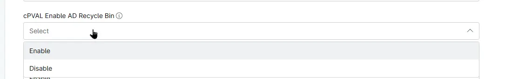

## Summary

Custom field to enable the Active Directory Recycle Bin on the domain controller

## Details

| Label | Field Name | Example | Definition Scope | Type | Required | Default Value | Dropdown Options | Editable | Custom Field Tab |
| ----- | ---------- | ------- | ---------------- | ---- | -------- | ------------- | ---------------- | -------- | ---------------- |
| cPVAL Enable AD Recycle Bin | cpvalEnableAdRecycleBin | | `Organization`, `Location`, `Device` | Drop-down | False | | <ul><li>Enable</li><li>Disable</li></ul> | Yes | Active Directory |

## Dependencies

* [Solution - AD Recycle Bin](/docs/56ed4b40-11ce-4f8d-b1ca-c897d2c496e6)

## Custom Field Creation

- [Custom Field Configuration](https://github.com/ProVal-Tech/ninjarmm/blob/main/custom-fields/cpval-enable-ad-recycle-bin.toml)

## Sample Screenshot

## Changelog

### 2026-10-29

- Initial version of the document
