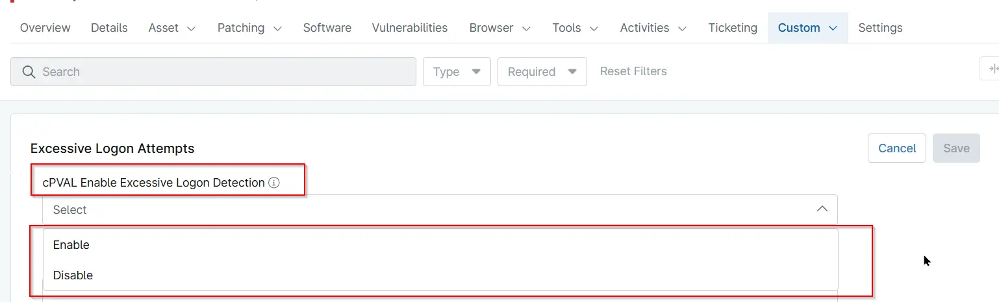

## Summary

Turns failed logon monitoring on or off for the [Excessive Logon Attempts](/docs/e99ec890-ae05-4ad5-bdbc-6b0599be67e9) solution. The solution counts failed logon attempts (Security event ID 4625) on domain controllers and raises an alert when the count reaches the configured threshold. A high number of failed logons can indicate a brute-force or password-spraying attack against domain accounts.

The `Monitor - Excessive Logon Attempts` compound condition reads this field before it runs the [Excessive Logon Attempts](/docs/3b52c821-6c63-4da6-87e8-8bd5c96e78de) script. The condition runs only on domain controllers whose [cPVAL Roles Detected](/docs/e9ec73dd-98b1-4436-a027-4ee8906f7cba) field contains `Infrastructure Master`, and it skips any device where this field is set to `Disable`.

| Option | Result |
| ------ | ------ |
| `Enable` | Failed logons are monitored, and an alert is raised when they reach the threshold. |
| `Disable` | Failed logons are not monitored, and no alert is raised. |
| Empty | Same as `Enable`. The compound condition skips a device only when the field is set to `Disable`. |

The field can be set at the organization, location or device level. A value set at a lower level overrides the value inherited from a higher level, so a single domain controller or location can be excluded without turning monitoring off for the whole organization.

## Details

| Label | Field Name | Example | Definition Scope | Type | Required | Default Value | Dropdown Options | Editable | Custom Field Tab |
| ----- | ---------- | ------- | ---------------- | ---- | -------- | ------------- | ---------------- | -------- | ---------------- |
| cPVAL Enable Excessive Logon Detection | cpvalEnableExcessiveLogonDetection | `Enable` | `Organization`, `Location`, `Device` | Drop-down | False | | <ul><li>Enable</li><li>Disable</li></ul> | Yes | Excessive Logon Failures Detection |

## Dependencies

- [Solution - Excessive Logon Attempts](/docs/e99ec890-ae05-4ad5-bdbc-6b0599be67e9)
- [Automation - Excessive Logon Attempts](/docs/3b52c821-6c63-4da6-87e8-8bd5c96e78de)
- [Custom Field - cPVAL Roles Detected](/docs/e9ec73dd-98b1-4436-a027-4ee8906f7cba)

## Custom Field Creation

- [Custom Field Configuration](https://github.com/ProVal-Tech/ninjarmm/blob/main/custom-fields/cpval-enable-excessive-logon-detection.toml)

## Sample Screenshot

## Changelog

### 2026-11-11

- Initial version of the document
