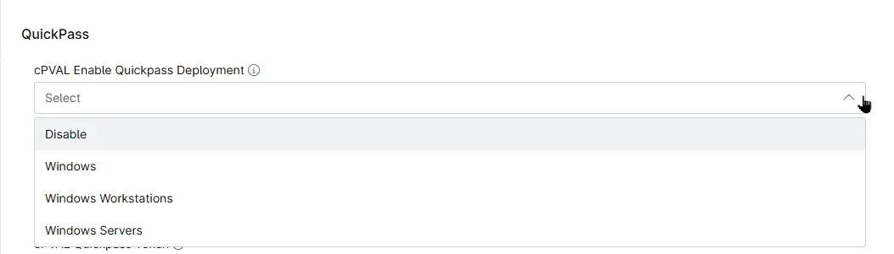

## Summary

Custom field to select the operating system for deploying QuickPass agents on the endpoints.

## Details

| Label | Field Name | Example | Definition Scope | Type | Required | Default Value | Dropdown Options | Editable | Custom Field Tab |
| ----- | ---------- | ------- | ---------------- | ---- | -------- | ------------- | ---------------- | -------- | ---------------- |
| cPVAL Enable QuickPass Deployment | cpvalEnableQuickpassDeployment | | `Organization`, `Location`, `Device` | Drop-down | False | | <ul><li>Disable</li><li>Windows</li><li>Windows Workstations</li><li>Windows Servers</li></ul> | Yes | QuickPass |

## Dependencies

* [Solution - Deploy QuickPass Agent](/docs/a68fa93c-45c7-4491-80d1-5e7543016b7f)

## Custom Field Creation

- [Custom Field Configuration](https://github.com/ProVal-Tech/ninjarmm/blob/main/custom-fields/cpval-enable-quickpass-deployment.toml)

## Sample Screenshot

## Changelog

### 2026-10-21

- Initial version of the document
