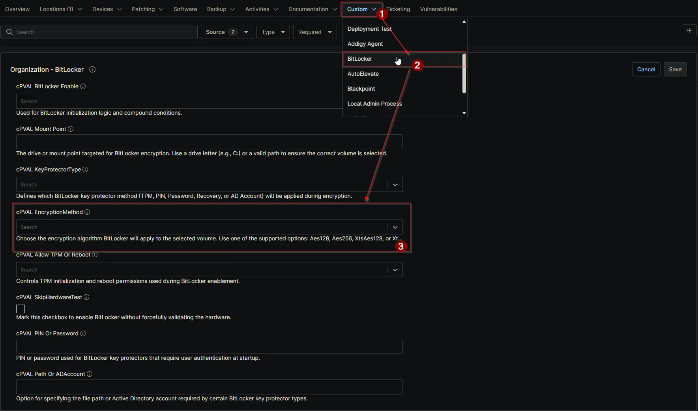

## Summary

The encryption method the [BitLocker Initialize - NinjaOne](/docs/2ebfabd5-05cf-4175-a513-2aa290eb26e8) solution uses when it encrypts the drive: `Aes128`, `Aes256`, `XtsAes128` or `XtsAes256`. When the field is blank, it uses `XtsAes128`.

:::note
Changing this field for devices that are already encrypted with another method makes the solution decrypt those drives and encrypt them again. The drive is unprotected while it decrypts, which can take hours, so change the method only when you need to. When the key protector needs a TPM, the solution starts this only when the TPM is ready.
:::

## Details

| Label | Field Name | Example | Definition Scope | Type | Required | Default Value | Dropdown Options | Editable | Custom Field Tab |
| ----- | ---------- | ------- | ---------------- | ---- | -------- | ------------- | ---------------- | -------- | ---------------- |
| cPVAL EncryptionMethod | cpvalEncryptionmethod | `XtsAes256` | `Organization`, `Location`, `Device` | `Drop-down` | `False` | `XtsAes128` | `Aes128`, `Aes256`, `XtsAes128`, `XtsAes256` | `Yes` | BitLocker |

## Dependencies

- [Automation: BitLocker Initialization - Detection](/docs/87d7a413-4bd4-4629-9475-35db91cb1320)
- [Automation: Initialize and Audit BitLocker](/docs/e3a24552-f347-4117-82f5-7afaaa3fc198)
- [Solution: BitLocker Initialize - NinjaOne](/docs/2ebfabd5-05cf-4175-a513-2aa290eb26e8)

## Custom Field Creation

- [Custom Field Configuration](https://github.com/ProVal-Tech/ninjarmm/blob/main/custom-fields/cpval-encryption-method.toml)

## Sample Screenshot

## Changelog

### 2026-10-26

- Added a note about changing the method on drives that are already encrypted.
- Updated the document to the standard format.

### 2025-12-16

- Initial version of the document
