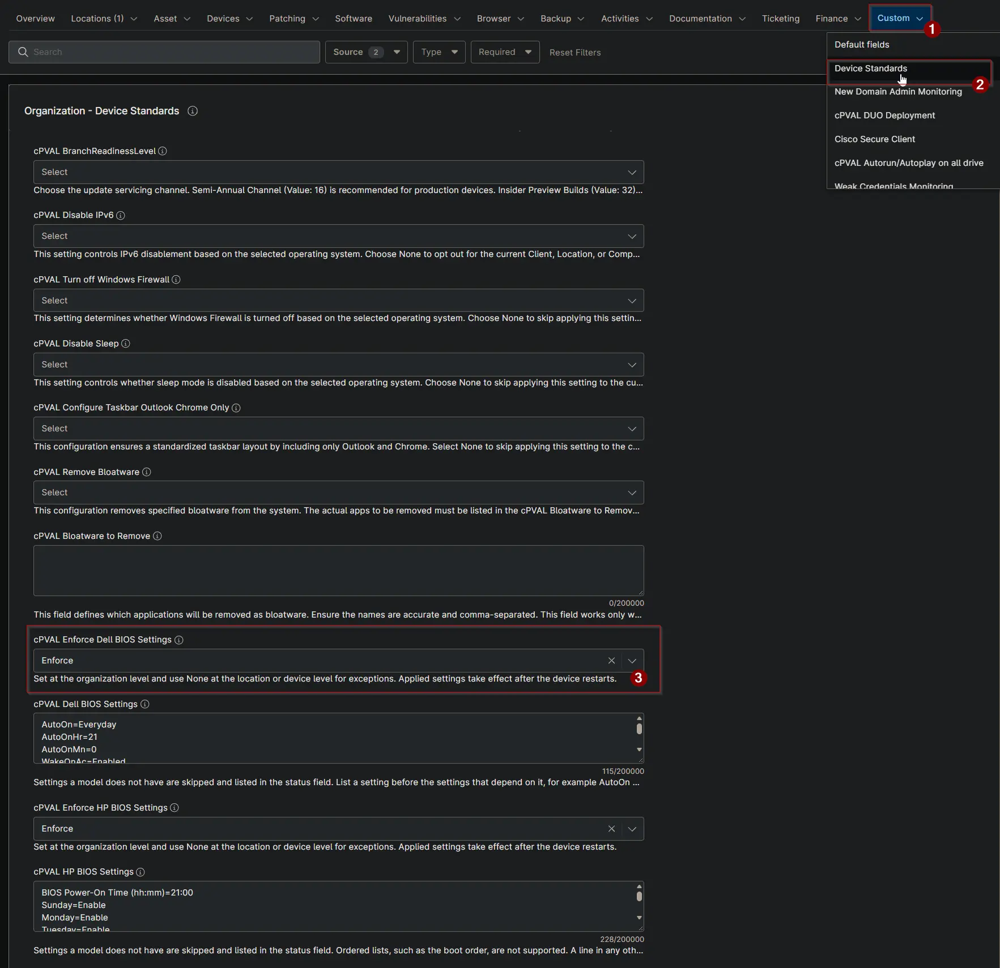

## Summary

This custom field turns the [Enforce Dell BIOS Settings](/docs/d3ee4598-13c1-4d19-8b6c-d368f2a00ab3) solution on or off. Use Audit to check Dell BIOS settings against [cPVAL Dell BIOS Settings](/docs/0ca65a80-d1c0-4ef9-b078-cd3e8d9d89db) without changing anything. Use Enforce to also apply the settings that differ.

## Details

| Label | Field Name | Example | Definition Scope | Type | Required | Default Value | Dropdown Options | Editable | Custom Field Tab |
| ----- | ---------- | ------- | ---------------- | ---- | -------- | ------------- | ---------------- | -------- | ---------------- |
| cPVAL Enforce Dell BIOS Settings | cpvalEnforceDellBiosSettings | Audit | Organization, Location, Device | Drop-down | False | | None, Audit, Enforce | Yes | Device Standards |

## Options

| Option | Result |
| ------ | ------ |
| None (or blank) | The device is skipped. |
| Audit | BIOS settings are checked and the result is stored in [cPVAL Dell BIOS Settings Status](/docs/1ddc8f49-ede2-4d44-871e-b448e8ba61ba). Nothing is changed. |
| Enforce | BIOS settings are checked, and the settings that differ are applied. The device must restart to complete the change. |

Set the field at the organization level. Select None at a location or device to exclude it.

## Dependencies

- [Solution: Enforce Dell BIOS Settings](/docs/d3ee4598-13c1-4d19-8b6c-d368f2a00ab3)
- [Solution: Device Standards](/docs/a0c383d4-699a-4bb8-af7f-c2a007747182)
- [Compound Condition: Enforce Dell BIOS Settings](/docs/86f44138-3e57-4c1f-8d7e-c4a0efc70fac)
- [Script: Check Dell BIOS Settings](/docs/a9117300-d45b-45e8-9cfe-e85859b1931b)
- [Script: Apply Dell BIOS Settings](/docs/b0c846eb-72d8-48ea-84b5-af87a02aa955)

## Custom Field Creation

- [Custom Field Configuration](https://github.com/ProVal-Tech/ninjarmm/blob/main/custom-fields/cpval-enforce-dell-bios-settings.toml)

## Sample Screenshot

## Changelog

### 2026-10-16

- Initial version of the document
