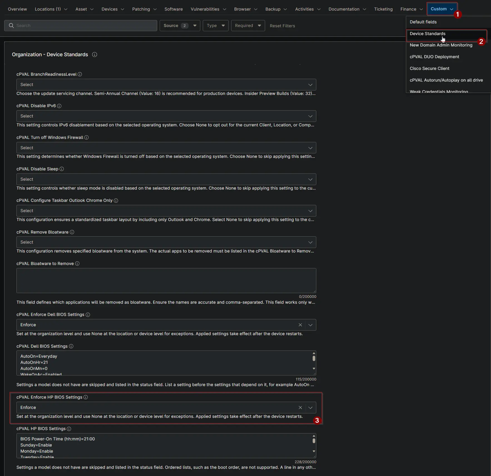

## Summary

This custom field turns the [Enforce HP BIOS Settings](/docs/ec68a35d-7884-4e39-bebb-6f2b37d77eca) solution on or off. Use Audit to check HP BIOS settings against [cPVAL HP BIOS Settings](/docs/91f31a3a-5d44-4a05-a1fd-5eba010aa03a) without changing anything. Use Enforce to also apply the settings that differ.

## Details

| Label | Field Name | Example | Definition Scope | Type | Required | Default Value | Dropdown Options | Editable | Custom Field Tab |
| ----- | ---------- | ------- | ---------------- | ---- | -------- | ------------- | ---------------- | -------- | ---------------- |
| cPVAL Enforce HP BIOS Settings | cpvalEnforceHpBiosSettings | Audit | Organization, Location, Device | Drop-down | False | | None, Audit, Enforce | Yes | Device Standards |

## Options

| Option | Result |
| ------ | ------ |
| None (or blank) | The device is skipped. |
| Audit | BIOS settings are checked and the result is stored in [cPVAL HP BIOS Settings Status](/docs/dae68716-9ea4-4f05-a0d4-4c2899fd22b7). Nothing is changed. |
| Enforce | BIOS settings are checked, and the settings that differ are applied. The device must restart to complete the change. |

Set the field at the organization level. Select None at a location or device to exclude it.

## Dependencies

- [Solution: Enforce HP BIOS Settings](/docs/ec68a35d-7884-4e39-bebb-6f2b37d77eca)
- [Solution: Device Standards](/docs/a0c383d4-699a-4bb8-af7f-c2a007747182)
- [Compound Condition: Enforce HP BIOS Settings](/docs/20215141-015b-4108-b40b-26070194acc1)
- [Script: Check HP BIOS Settings](/docs/d04025b0-cb2a-4f49-b211-4e13c181d2f3)
- [Script: Apply HP BIOS Settings](/docs/c338d928-7659-4ade-862c-7f8cebc3472d)

## Custom Field Creation

- [Custom Field Configuration](https://github.com/ProVal-Tech/ninjarmm/blob/main/custom-fields/cpval-enforce-hp-bios-settings.toml)

## Sample Screenshot

## Changelog

### 2026-10-16

- Initial version of the document
