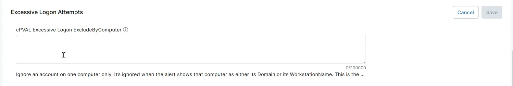

## Summary

Lists the computer and account pairs that the [Excessive Logon Attempts](/docs/e99ec890-ae05-4ad5-bdbc-6b0599be67e9) solution ignores when it counts failed logon attempts (Security event ID 4625). A failed logon is ignored when its account matches an entry and the computer in that entry is either the account's domain or the workstation the attempt came from. Failed logons ignored this way never count toward the alert threshold.

Use it for an account that is only expected to fail on or from one computer, such as the local account on a front desk PC. The same account failing on or from any other computer still counts.

## Entering Entries

- Write each entry as `COMPUTER\account`. A forward slash also works, as in `COMPUTER/account`.
- Separate entries with commas, semicolons or line breaks.
- Use `*` to match any number of characters and `?` to match exactly one character, in either part of the entry. `COMPUTER\*` matches every account.
- Matching is not case-sensitive, and quotes are not needed.
- An entry that does not have both a computer and an account, such as `FRONTDESK-01` on its own, is skipped.

| Entry | What it ignores |
| ----- | --------------- |
| `FRONTDESK-01\reception` | The local account `reception` on `FRONTDESK-01`, and any account named `reception`, including `CONTOSO\reception`, failing from `FRONTDESK-01`. |
| `LAB-PC07\*` | Every account whose domain or workstation is `LAB-PC07`. |
| `POS-*\cashier` | The account `cashier` on, or from, every computer whose name starts with `POS-`. |

## How Entries Are Matched

The computer part of an entry is compared with two fields of each failed logon. Both fields appear under the same names in the alert.

| Field | What it holds |
| ----- | ------------- |
| `Domain` | The domain of the account that failed, such as `CONTOSO`. For a local account it is the name of the computer the account belongs to, such as `FRONTDESK-01`. |
| `WorkstationName` | The name of the computer the attempt came from, as reported by that computer. It can be empty or `-`. Source IP addresses are not matched. |

Checking both fields covers both sides of a local account on one PC: failures of the local account itself, and failures that come from that PC. To match only one of these fields, use [cPVAL Excessive Logon ExcludeByDomain](/docs/a0bac62e-ca7d-47e4-9b40-0ef534b99260), which checks only the account's domain, or [cPVAL Excessive Logon ExcludeByWorkstation](/docs/75819933-6303-4b48-b3e6-c0c26e125142), which checks only the computer the attempt came from.

The account part of an entry is compared with both the username and the workstation name. It is normally a username, but it can also be a workstation name.

To ignore an account everywhere rather than on one computer, use [cPVAL Excessive Logon ExcludeUsers](/docs/655756eb-8031-443a-8483-9509009523a1) instead.

**Note:** Avoid broad patterns such as `*\*` or `*\Administrator`. They hide failed logons from real attacks along with the harmless ones. Because the workstation name is reported by the computer that makes the attempt, any computer can report a name that matches an entry, so prefer naming a specific account over `COMPUTER\*`.

The field can be set at the organization, location or device level. A value set at a lower level replaces the inherited value instead of adding to it. To keep the organization's entries on a single device, include them in the device's value as well.

## Details

| Label | Field Name | Example | Definition Scope | Type | Required | Default Value | Dropdown Options | Editable | Custom Field Tab |
| ----- | ---------- | ------- | ---------------- | ---- | -------- | ------------- | ---------------- | -------- | ---------------- |
| cPVAL Excessive Logon ExcludeByComputer | cpvalExcessiveLogonExcludebycomputer | `FRONTDESK-01\reception; LAB-PC07\*` | `Organization`, `Location`, `Device` | Multi-line | False | | | Yes | Excessive Logon Failures Detection |

## Dependencies

- [Solution - Excessive Logon Attempts](/docs/e99ec890-ae05-4ad5-bdbc-6b0599be67e9)
- [Automation - Excessive Logon Attempts](/docs/3b52c821-6c63-4da6-87e8-8bd5c96e78de)
- [Custom Field - cPVAL Enable Excessive Logon Detection](/docs/57a80bea-ffac-4925-bc95-c51bf6db01f1)

## Custom Field Creation

- [Custom Field Configuration](https://github.com/ProVal-Tech/ninjarmm/blob/main/custom-fields/cpval-excessive-logon-excludebycomputer.toml)

## Sample Screenshot

## Changelog

### 2026-11-11

- Initial version of the document
