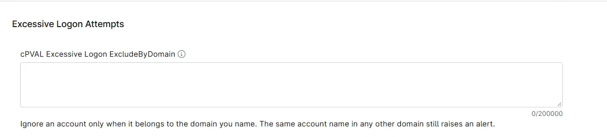

## Summary

Lists the domain and account pairs that the [Excessive Logon Attempts](/docs/e99ec890-ae05-4ad5-bdbc-6b0599be67e9) solution ignores when it counts failed logon attempts (Security event ID 4625). A failed logon is ignored only when its account belongs to the domain in the entry, meaning the `Domain` shown in the alert. The same account name in any other domain still counts toward the alert threshold.

Use it to ignore an account in one domain while still alerting on an account with the same name elsewhere, or to ignore every account in a domain with `DOMAIN\*`.

## Entering Entries

- Write each entry as `DOMAIN\account`. A forward slash also works, as in `DOMAIN/account`.
- For a local account, `DOMAIN` is the name of the computer the account belongs to, such as `SERVER01`.
- Separate entries with commas, semicolons or line breaks.
- Use `*` to match any number of characters and `?` to match exactly one character, in either part of the entry. `DOMAIN\*` matches every account in that domain.
- Matching is not case-sensitive, and quotes are not needed.
- An entry that does not have both a domain and an account, such as `CONTOSO` on its own, is skipped.

| Entry | What it ignores |
| ----- | --------------- |
| `CONTOSO\svc_scan` | The domain account `CONTOSO\svc_scan`. A local account named `svc_scan` still raises the alert. |
| `SERVER01\Administrator` | The local `Administrator` account of `SERVER01`. `CONTOSO\Administrator` still raises the alert, even when it fails from `SERVER01`. |
| `FABRIKAM\*` | Every account in the `FABRIKAM` domain. |
| `CONTOSO\KIOSK-*` | Every `CONTOSO` account failing from a workstation whose name starts with `KIOSK-`, and every `CONTOSO` account whose name starts with `KIOSK-`. |

## How Entries Are Matched

The domain part of an entry is compared only with the `Domain` field of each failed logon, which appears under the same name in the alert. For a domain account, `Domain` is the domain name, such as `CONTOSO`. For a local account, it is the name of the computer the account belongs to.

The computer the attempt came from (`WorkstationName`) is not compared with the domain part. This is the difference from [cPVAL Excessive Logon ExcludeByComputer](/docs/ab58f702-6829-4c77-b155-9da7e916d24b), which also matches the computer the attempt came from. For example, `SERVER01\Administrator` in ExcludeByComputer also ignores `CONTOSO\Administrator` failing from `SERVER01`, while the same entry in this field does not.

The account part of an entry is compared with both the username and the workstation name. It is normally a username, but it can also be a workstation name, as in the `CONTOSO\KIOSK-*` example above.

To ignore an account in every domain, use [cPVAL Excessive Logon ExcludeUsers](/docs/655756eb-8031-443a-8483-9509009523a1) instead.

**Note:** Do not add `DOMAIN\*` for the domain that the monitored domain controllers serve. It ignores every failed logon for that domain's accounts, which are the failures this solution is meant to catch. Use `DOMAIN\*` only for a domain whose failed logons do not need to be monitored here.

The field can be set at the organization, location or device level. A value set at a lower level replaces the inherited value instead of adding to it. To keep the organization's entries on a single device, include them in the device's value as well.

## Details

| Label | Field Name | Example | Definition Scope | Type | Required | Default Value | Dropdown Options | Editable | Custom Field Tab |
| ----- | ---------- | ------- | ---------------- | ---- | -------- | ------------- | ---------------- | -------- | ---------------- |
| cPVAL Excessive Logon ExcludeByDomain | cpvalExcessiveLogonExcludebydomain | `CONTOSO\svc_scan; FABRIKAM\*` | `Organization`, `Location`, `Device` | Multi-line | False | | | Yes | Excessive Logon Failures Detection |

## Dependencies

- [Solution - Excessive Logon Attempts](/docs/e99ec890-ae05-4ad5-bdbc-6b0599be67e9)
- [Automation - Excessive Logon Attempts](/docs/3b52c821-6c63-4da6-87e8-8bd5c96e78de)
- [Custom Field - cPVAL Enable Excessive Logon Detection](/docs/57a80bea-ffac-4925-bc95-c51bf6db01f1)

## Custom Field Creation

- [Custom Field Configuration](https://github.com/ProVal-Tech/ninjarmm/blob/main/custom-fields/cpval-excessive-logon-excludebydomain.toml)

## Sample Screenshot

## Changelog

### 2026-11-11

- Initial version of the document
