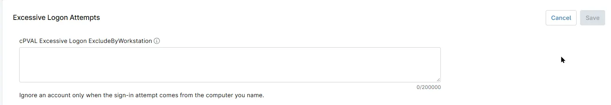

## Summary

Lists the workstation and account pairs that the [Excessive Logon Attempts](/docs/e99ec890-ae05-4ad5-bdbc-6b0599be67e9) solution ignores when it counts failed logon attempts (Security event ID 4625). A failed logon is ignored only when it comes from the workstation in the entry, meaning the `WorkstationName` shown in the alert. The same account failing from any other computer still counts toward the alert threshold.

Use it for a device that is known to send bad logons, such as a copier that scans to a shared folder, or an old laptop that still has a saved password that has since been changed.

## Entering Entries

- Write each entry as `WORKSTATION\account`. A forward slash also works, as in `WORKSTATION/account`.
- Separate entries with commas, semicolons or line breaks.
- Use `*` to match any number of characters and `?` to match exactly one character, in either part of the entry. `WORKSTATION\*` matches every account that fails from that workstation.
- Matching is not case-sensitive, and quotes are not needed.
- An entry that does not have both a workstation and an account, such as `COPIER-2F` on its own, is skipped.

| Entry | What it ignores |
| ----- | --------------- |
| `COPIER-2F\scan2folder` | The account `scan2folder` failing from the copier `COPIER-2F`. The same account failing from anywhere else still raises the alert. |
| `TRAINING-*\*` | Every account failing from any computer whose name starts with `TRAINING-`. |
| `LAPTOP-JDOE\jdoe@contoso.com` | `jdoe` signing in with an email-style name (UPN) from `LAPTOP-JDOE`. |

## How Entries Are Matched

The workstation part of an entry is compared only with the `WorkstationName` field of each failed logon, which appears under the same name in the alert. It holds the name of the computer the attempt came from, as reported by that computer. Source IP addresses are not matched.

`WorkstationName` can be empty or `-`, for example when the attempt comes from a device that does not report its name. A failed logon without a workstation name is not matched by an entry that names a computer.

The account's domain (`Domain`) is not compared with the workstation part. This is the difference from [cPVAL Excessive Logon ExcludeByComputer](/docs/ab58f702-6829-4c77-b155-9da7e916d24b), which matches either the account's domain or the computer the attempt came from, and [cPVAL Excessive Logon ExcludeByDomain](/docs/a0bac62e-ca7d-47e4-9b40-0ef534b99260), which matches only the account's domain. For example, `FRONTDESK-01\reception` in ExcludeByComputer also ignores the local account `reception` of `FRONTDESK-01` failing from another computer, while the same entry in this field does not.

The account part of an entry is compared with both the username and the workstation name. It is normally a username, but it can also be a workstation name.

To ignore an account from every workstation, use [cPVAL Excessive Logon ExcludeUsers](/docs/655756eb-8031-443a-8483-9509009523a1) instead.

**Note:** The workstation name is reported by the computer that makes the attempt, so any computer, including one used in an attack, can report a name that matches an entry. Prefer naming a specific account over `WORKSTATION\*`, and avoid broad patterns such as `*\*`, which ignore almost every failed logon.

The field can be set at the organization, location or device level. A value set at a lower level replaces the inherited value instead of adding to it. To keep the organization's entries on a single device, include them in the device's value as well.

## Details

| Label | Field Name | Example | Definition Scope | Type | Required | Default Value | Dropdown Options | Editable | Custom Field Tab |
| ----- | ---------- | ------- | ---------------- | ---- | -------- | ------------- | ---------------- | -------- | ---------------- |
| cPVAL Excessive Logon ExcludeByWorkstation | cpvalExcessiveLogonExcludebyworkstation | `COPIER-2F\scan2folder; TRAINING-*\*` | `Organization`, `Location`, `Device` | Multi-line | False | | | Yes | Excessive Logon Failures Detection |

## Dependencies

- [Solution - Excessive Logon Attempts](/docs/e99ec890-ae05-4ad5-bdbc-6b0599be67e9)
- [Automation - Excessive Logon Attempts](/docs/3b52c821-6c63-4da6-87e8-8bd5c96e78de)
- [Custom Field - cPVAL Enable Excessive Logon Detection](/docs/57a80bea-ffac-4925-bc95-c51bf6db01f1)

## Custom Field Creation

- [Custom Field Configuration](https://github.com/ProVal-Tech/ninjarmm/blob/main/custom-fields/cpval-excessive-logon-excludebyworkstation.toml)

## Sample Screenshot

## Changelog

### 2026-11-11

- Initial version of the document
