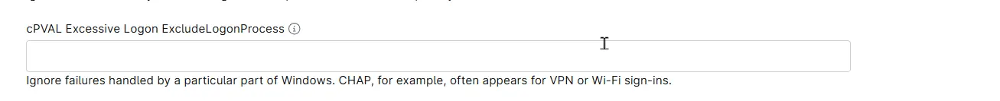

## Summary

Lists the logon processes that the [Excessive Logon Attempts](/docs/e99ec890-ae05-4ad5-bdbc-6b0599be67e9) solution ignores when it counts failed logon attempts (Security event ID 4625). The logon process is the Windows component that handled the attempt, so this field ignores a whole kind of logon rather than a particular account. Failed logons ignored this way never count toward the alert threshold, wherever they come from and whichever account they use.

Use it for a kind of logon whose failures are expected and monitored elsewhere, such as VPN or RADIUS logons.

## Entering Logon Processes

- Separate logon process names with commas or semicolons.
- Use `*` to match any number of characters and `?` to match exactly one character.
- Matching is not case-sensitive, and quotes are not needed.

| Entry | What it ignores |
| ----- | --------------- |
| `CHAP` | VPN and RADIUS logon failures. |
| `Advapi, Seclogo` | Failures from programs that check a password, and from `Run as different user`. |

## Common Logon Processes

Each name is compared with the `LogonProcess` field of each failed logon, which appears under the same name in the alert.

| Logon Process | Kind of logon |
| ------------- | ------------- |
| `NtLmSsp` | Network logons that use NTLM, such as file shares and Remote Desktop with Network Level Authentication (NLA). Most password-guessing attacks from the network use it. |
| `Kerberos` | Network logons that use Kerberos. |
| `User32` | Logons at the keyboard, or through Remote Desktop without NLA. |
| `Advapi` | Logons made by programs that check a password, such as IIS Basic authentication. |
| `Seclogo` | `Run as different user`. |
| `CHAP` | VPN or RADIUS logons checked by Routing and Remote Access (RRAS) or Network Policy Server (NPS). |

**Note:** Do not add `NtLmSsp` or `User32`. They ignore the failed logons from most password-guessing attacks, which are the failures this solution is meant to catch. Avoid `*` for the same reason, as it ignores every failed logon.

The field can be set at the organization, location or device level. A value set at a lower level replaces the inherited value instead of adding to it. To keep the organization's logon processes on a single device, include them in the device's value as well.

## Details

| Label | Field Name | Example | Definition Scope | Type | Required | Default Value | Dropdown Options | Editable | Custom Field Tab |
| ----- | ---------- | ------- | ---------------- | ---- | -------- | ------------- | ---------------- | -------- | ---------------- |
| cPVAL Excessive Logon ExcludeLogonProcess | cpvalExcessiveLogonExcludelogonprocess | `CHAP; Advapi; Seclogo` | `Organization`, `Location`, `Device` | Text | False | | | Yes | Excessive Logon Failures Detection |

## Dependencies

- [Solution - Excessive Logon Attempts](/docs/e99ec890-ae05-4ad5-bdbc-6b0599be67e9)
- [Automation - Excessive Logon Attempts](/docs/3b52c821-6c63-4da6-87e8-8bd5c96e78de)
- [Custom Field - cPVAL Enable Excessive Logon Detection](/docs/57a80bea-ffac-4925-bc95-c51bf6db01f1)

## Custom Field Creation

- [Custom Field Configuration](https://github.com/ProVal-Tech/ninjarmm/blob/main/custom-fields/cpval-excessive-logon-excludelogonprocess.toml)

## Sample Screenshot

## Changelog

### 2026-11-11

- Initial version of the document
