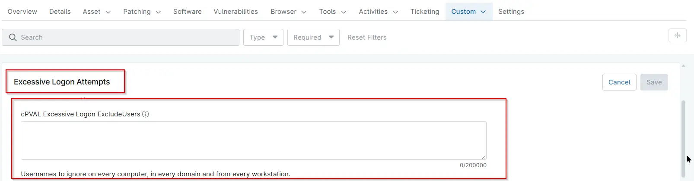

## Summary

Lists the usernames that the [Excessive Logon Attempts](/docs/e99ec890-ae05-4ad5-bdbc-6b0599be67e9) solution ignores when it counts failed logon attempts (Security event ID 4625). Failed logons from these accounts never count toward the alert threshold. Use it for accounts that are known to fail harmlessly everywhere, such as a scanner account.

## Entering Usernames

- Separate usernames with commas, semicolons or line breaks.
- Use `*` to match any number of characters and `?` to match exactly one character.
- Matching is not case-sensitive, and quotes are not needed.

| Entry | What it ignores |
| ----- | --------------- |
| `scanner, svc_backup` | Exactly these two accounts. |
| `svc_*` | Every account whose name starts with `svc_`, such as `svc_backup` and `svc_sql`. |
| `kiosk??` | `kiosk` followed by exactly two characters, such as `kiosk01` and `kiosk02`. |
| `*$` | Every computer (machine) account. |

Only the username is checked, not the domain. For example, `scanner` ignores both the domain account `CONTOSO\scanner` and the local account `SERVER01\scanner`. To ignore an account only on one computer, in one domain or from one workstation, use the [cPVAL Excessive Logon ExcludeByComputer](/docs/ab58f702-6829-4c77-b155-9da7e916d24b), [cPVAL Excessive Logon ExcludeByDomain](/docs/a0bac62e-ca7d-47e4-9b40-0ef534b99260) or [cPVAL Excessive Logon ExcludeByWorkstation](/docs/75819933-6303-4b48-b3e6-c0c26e125142) field instead.

**Note:** Avoid broad patterns such as `*` or `a*`. They hide failed logons from real attacks along with the harmless ones.

The field can be set at the organization, location or device level. A value set at a lower level replaces the inherited value instead of adding to it. To keep the organization's usernames on a single device, include them in the device's value as well.

## Details

| Label | Field Name | Example | Definition Scope | Type | Required | Default Value | Dropdown Options | Editable | Custom Field Tab |
| ----- | ---------- | ------- | ---------------- | ---- | -------- | ------------- | ---------------- | -------- | ---------------- |
| cPVAL Excessive Logon ExcludeUsers | cpvalExcessiveLogonExcludeusers | `scanner; svc_*; *$` | `Organization`, `Location`, `Device` | Multi-line | False | | | Yes | Excessive Logon Failures Detection |

## Dependencies

- [Solution - Excessive Logon Attempts](/docs/e99ec890-ae05-4ad5-bdbc-6b0599be67e9)
- [Automation - Excessive Logon Attempts](/docs/3b52c821-6c63-4da6-87e8-8bd5c96e78de)
- [Custom Field - cPVAL Enable Excessive Logon Detection](/docs/57a80bea-ffac-4925-bc95-c51bf6db01f1)

## Custom Field Creation

- [Custom Field Configuration](https://github.com/ProVal-Tech/ninjarmm/blob/main/custom-fields/cpval-excessive-logon-excludeusers.toml)

## Sample Screenshot

## Changelog

### 2026-11-11

- Initial version of the document
