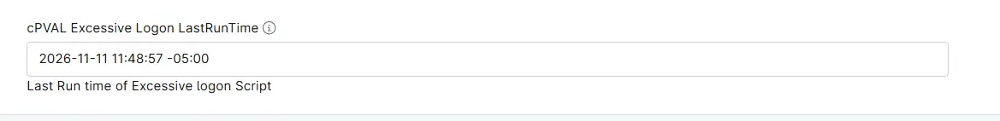

## Summary

Stores the time the [Excessive Logon Attempts](/docs/3b52c821-6c63-4da6-87e8-8bd5c96e78de) script last ran on the device. The script reads and writes this field on every run, and it does not need to be filled in manually.

Each run counts the failed logon attempts (Security event ID 4625) recorded from the time in this field up to the moment the run started, and then saves that start time for the next run. Runs therefore never overlap or leave gaps, whatever the schedule. After a device has been offline, the next run covers the whole time since the last run.

The time is saved as local time with its UTC offset, such as `2026-11-11 10:21:03 -05:00`, so it is readable in NinjaOne and stays correct across daylight saving and time zone changes. The script output shows the exact period each run checked.

## How the Field Is Used

| Field value | What the next run checks |
| ----------- | ------------------------ |
| A valid time in the past | Failed logons from that time up to the start of the run. |
| Empty, such as on the first run | Failed logons in the last 60 minutes. |
| A time in the future, or text that is not a time | Failed logons in the last 60 minutes. |

- The time is saved on every run that reads the Security log, whether or not the run raises an alert.
- If the Security log cannot be read, the run fails without updating the field, so the next run covers the missed period as well.
- A time typed into the field without a UTC offset, such as `2026-11-11 05:00:00`, is read as local time. Setting an earlier time makes the next run check the failed logons again from that time.
- Clearing the field makes the next run check only the last 60 minutes.
- Unix epoch values saved by earlier versions of the script, such as `1794410463`, are still read, and the next run replaces them with the readable format.

**Note:** If the script cannot save the time, its output shows a `[WARNING] Unable to save ... as the last run time` line. Make sure the field exists as a Text field with `Read/Write` automation access. Until then, each run checks only the last 60 minutes, so failed logons that occur between runs more than 60 minutes apart are missed.

## Details

| Label | Field Name | Example | Definition Scope | Type | Required | Default Value | Dropdown Options | Editable | Custom Field Tab |
| ----- | ---------- | ------- | ---------------- | ---- | -------- | ------------- | ---------------- | -------- | ---------------- |
| cPVAL Excessive Logon LastRunTime | cpvalExcessiveLogonLastruntime | `2026-11-11 10:21:03 -05:00` | `Device` | Text | False | | | Yes | Excessive Logon Failures Detection |

## Dependencies

- [Solution - Excessive Logon Attempts](/docs/e99ec890-ae05-4ad5-bdbc-6b0599be67e9)
- [Automation - Excessive Logon Attempts](/docs/3b52c821-6c63-4da6-87e8-8bd5c96e78de)
- [Custom Field - cPVAL Enable Excessive Logon Detection](/docs/57a80bea-ffac-4925-bc95-c51bf6db01f1)
- [Custom Field - cPVAL Excessive Logon Threshold](/docs/59804ada-96af-48b6-ab50-e975b531351e)

## Custom Field Creation

- [Custom Field Configuration](https://github.com/ProVal-Tech/ninjarmm/blob/main/custom-fields/cpval-excessive-logon-lastruntime.toml)

## Sample Screenshot

## Changelog

### 2026-11-11

- Initial version of the document
