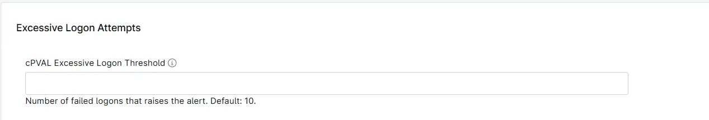

## Summary

Sets how many failed logon attempts (Security event ID 4625) since the last run raise the alert in the [Excessive Logon Attempts](/docs/e99ec890-ae05-4ad5-bdbc-6b0599be67e9) solution. The alert is raised when the count is equal to or greater than this number.

The count is a total for the device, not a limit per user. Failed logons from all users and all sources are added together. Only the failed logons that are left after the built-in filters and the configured exclusions are counted.

| Value | Result |
| ----- | ------ |
| Empty | The default threshold of `10` is used. |
| `5` | Alerts on 5 or more failed logons. Suits an environment where failed logons are rare. |
| `25` | Alerts on 25 or more failed logons. Suits a busy environment where many users mistype their passwords during the day. |
| `0`, a negative number or text that is not a number | Treated as empty, so the default threshold of `10` is used. |

## How the Count Works

Each run of the [Excessive Logon Attempts](/docs/3b52c821-6c63-4da6-87e8-8bd5c96e78de) script counts the failed logons recorded since the previous run, using the time saved in [cPVAL Excessive Logon LastRunTime](/docs/1e9de0b4-cf50-419a-95b5-bd1e1fbf3599). The threshold therefore works together with how often the `Monitor - Excessive Logon Attempts` compound condition runs the script. For example, a threshold of `10` on a script that runs every hour means 10 or more failed logons in an hour. When the schedule changes, review the threshold as well.

These failed logons are never counted:

- Batch (logon type 4) and service (logon type 5) logons.
- A computer (machine) account failing from its own workstation, such as `PC69$` from `PC69`.
- Failed logons that match any of the exclusion fields:
  - [cPVAL Excessive Logon ExcludeUsers](/docs/655756eb-8031-443a-8483-9509009523a1)
  - [cPVAL Excessive Logon ExcludeByComputer](/docs/ab58f702-6829-4c77-b155-9da7e916d24b)
  - [cPVAL Excessive Logon ExcludeByDomain](/docs/a0bac62e-ca7d-47e4-9b40-0ef534b99260)
  - [cPVAL Excessive Logon ExcludeByWorkstation](/docs/75819933-6303-4b48-b3e6-c0c26e125142)
  - [cPVAL Excessive Logon ExcludeLogonProcess](/docs/5e936fa9-8345-47e2-826d-7a74144c1787)

The script lists the failed logons it counted in its output on every run that counts any, even when the count stays below the threshold. The threshold only decides whether the run raises the alert.

The field can be set at the organization, location or device level. A value set at a lower level overrides the value inherited from a higher level, so a busy domain controller or location can have a higher threshold than the rest of the organization.

## Details

| Label | Field Name | Example | Definition Scope | Type | Required | Default Value | Dropdown Options | Editable | Custom Field Tab |
| ----- | ---------- | ------- | ---------------- | ---- | -------- | ------------- | ---------------- | -------- | ---------------- |
| cPVAL Excessive Logon Threshold | cpvalExcessiveLogonThreshold | `10` | `Organization`, `Location`, `Device` | Text | False | | | Yes | Excessive Logon Failures Detection |

## Dependencies

- [Solution - Excessive Logon Attempts](/docs/e99ec890-ae05-4ad5-bdbc-6b0599be67e9)
- [Automation - Excessive Logon Attempts](/docs/3b52c821-6c63-4da6-87e8-8bd5c96e78de)
- [Custom Field - cPVAL Enable Excessive Logon Detection](/docs/57a80bea-ffac-4925-bc95-c51bf6db01f1)

## Custom Field Creation

- [Custom Field Configuration](https://github.com/ProVal-Tech/ninjarmm/blob/main/custom-fields/cpval-excessive-logon-threshold.toml)

## Sample Screenshot

## Changelog

### 2026-11-11

- Initial version of the document
