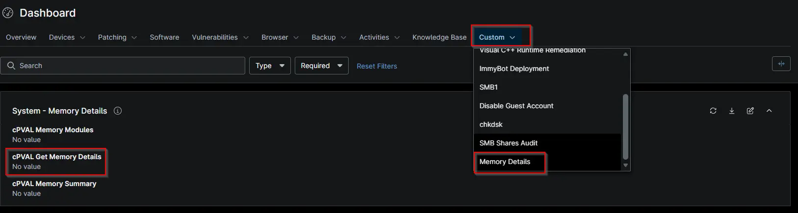

## Summary

Select OS where the audit for memory details should run. Choosing `Disabled` will exclude the devices.

## Details

| Label | Field Name | Example | Definition Scope | Type | Required | Default Value | Dropdown Options | Editable | Custom Field Tab |
| ---- | ---- | ---- | ---- | ---- | ---- | ---- | ---- | ---- | ---- |
| cPVAL Get Memory Details | cpvalGetMemoryDetails | --- | `Location`, `Organization`,`Device`, `System` | `DropDown` | false | -- | `Disabled`, `Windows`, `Windows servers`, `Windows Workstations` | True | Memory Details |

## Dependencies

- [Solution: Get Detailed Memory Information - NinjaOne](/docs/fd8c41d3-ecf7-4eb8-95f5-4317a787a579)
- [Compound Condition: Get Detailed Memory Information - Workstations](/docs/62d1b964-0aca-4406-bfd7-c6f446418029)
- [Compound Condition: Get Detailed Memory Information - Servers](/docs/3e5b56c4-7ac8-48ef-8332-ce6c683ff492)

## Custom Field Creation

- [Custom Field Configuration](https://github.com/ProVal-Tech/ninjarmm/blob/main/custom-fields/cpval-get-memory-details.toml )

## Sample Screenshot

## Changelog

### 2026-11-02

- Initial version of the document