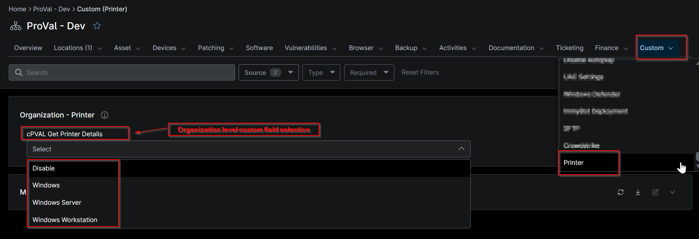
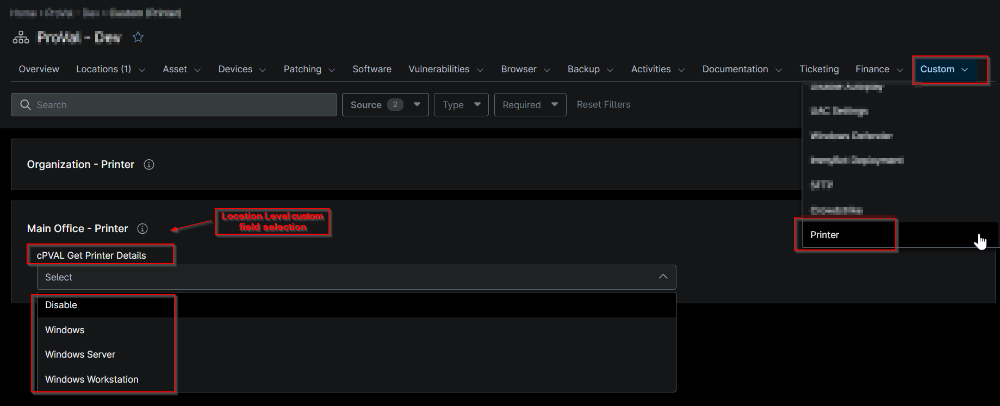

## Summary

Select the options to enable or disable auditing of printer details on endpoints.

## Details

| Label | Field Name | Example | Definition Scope | Type | Required | Default Value | Dropdown Options | Editable | Custom Field Tab |
| ----- | ---------- | ------- | ---------------- | ---- | -------- | ------------- | ---------------- | -------- | ---------------- |
| cPVAL Get Printer Details | cpvalGetPrinterDetails | Windows | `Organization`, `Location`, `Device` | Drop-down | false |  | `Disabled`, `Windows`, `Windows Workstation`, `Windows Server` | Yes | Printer |

## Dependencies

- [Solution - Get Printer Details](/docs/b5c871cf-f8fc-4fde-b20c-5aabd7341ade)

## Custom Field Creation

- [Custom Field Configuration](https://github.com/ProVal-Tech/ninjarmm/blob/main/custom-fields/cpval-get-printer-details.toml)

## Sample Screenshot

## Changelog

### 2026-10-13

- Initial version of the document
