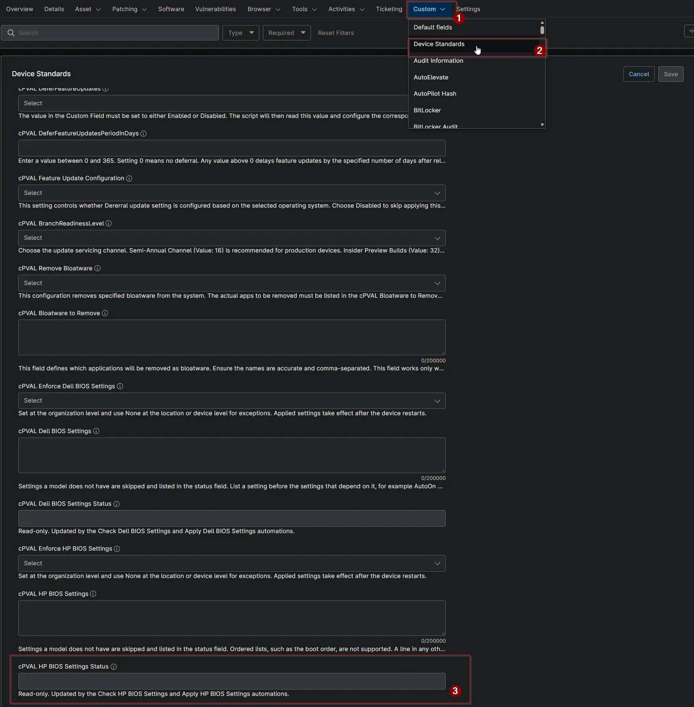

## Summary

This custom field shows the result of the [Enforce HP BIOS Settings](/docs/ec68a35d-7884-4e39-bebb-6f2b37d77eca) solution on a device. It is updated by the [Check HP BIOS Settings](/docs/d04025b0-cb2a-4f49-b211-4e13c181d2f3) and [Apply HP BIOS Settings](/docs/c338d928-7659-4ade-862c-7f8cebc3472d) automations and is read-only for technicians.

## Details

| Label | Field Name | Example | Definition Scope | Type | Required | Default Value | Dropdown Options | Editable | Custom Field Tab |
| ----- | ---------- | ------- | ---------------- | ---- | -------- | ------------- | ---------------- | -------- | ---------------- |
| cPVAL HP BIOS Settings Status | cpvalHpBiosSettingsStatus | Compliant | Device | Text | False | | | No | Device Standards |

## Status Values

Each value shows the status, the date and time it was first recorded, and details when there are any.

```PlainText
Compliant | 2026-10-16 21:05:12
Compliant | 2026-10-16 21:05:12 | Not supported: After Power Loss
Non-Compliant | 2026-10-16 21:05:12 | Mismatch: Wake On LAN, Sunday
Applied - Reboot Pending | 2026-10-16 21:05:12 | Changed: Wake On LAN, Sunday
Failed | 2026-10-16 21:05:12 | Invalid value: Wake On LAN=Enable (valid: Disable, Boot to Network, Boot to Hard Drive)
```

| Status | Meaning | Action |
| ------ | ------- | ------ |
| Compliant | Every supported setting matches. Not supported lists the settings this model does not have. | None. |
| Non-Compliant | At least one setting differs. Shown in Audit mode only. | Review the settings, then switch [cPVAL Enforce HP BIOS Settings](/docs/d6023b8f-c04c-4453-89ce-bc729be9fb79) to Enforce. |
| Applied - Reboot Pending | The settings were changed and take effect after a restart. The device is not checked again until it restarts. | Restart the device. |
| Failed | The settings could not be read or applied. The reason follows the date. | Fix the reason, for example the format of [cPVAL HP BIOS Settings](/docs/91f31a3a-5d44-4a05-a1fd-5eba010aa03a). |

Use this field to build device groups, for example devices whose status contains Reboot Pending or Failed.

## Dependencies

- [Solution: Enforce HP BIOS Settings](/docs/ec68a35d-7884-4e39-bebb-6f2b37d77eca)
- [Solution: Device Standards](/docs/a0c383d4-699a-4bb8-af7f-c2a007747182)
- [Script: Check HP BIOS Settings](/docs/d04025b0-cb2a-4f49-b211-4e13c181d2f3)
- [Script: Apply HP BIOS Settings](/docs/c338d928-7659-4ade-862c-7f8cebc3472d)

## Custom Field Creation

- [Custom Field Configuration](https://github.com/ProVal-Tech/ninjarmm/blob/main/custom-fields/cpval-hp-bios-settings-status.toml)

## Sample Screenshot



## Changelog

### 2026-10-16

- Initial version of the document
