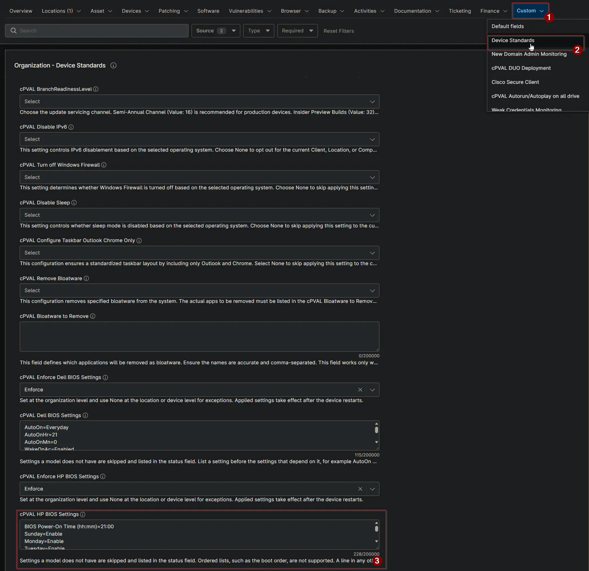

## Summary

This custom field stores the HP BIOS settings that devices should have. The [Check HP BIOS Settings](/docs/d04025b0-cb2a-4f49-b211-4e13c181d2f3) and [Apply HP BIOS Settings](/docs/c338d928-7659-4ade-862c-7f8cebc3472d) automations compare the device with these settings.

## Details

| Label | Field Name | Example | Definition Scope | Type | Required | Default Value | Dropdown Options | Editable | Custom Field Tab |
| ----- | ---------- | ------- | ---------------- | ---- | -------- | ------------- | ---------------- | -------- | ---------------- |
| cPVAL HP BIOS Settings | cpvalHpBiosSettings | `Wake On LAN=Boot to Hard Drive` | Organization, Location, Device | Multi-line | False | | | Yes | Device Standards |

## Format

Enter one setting per line in the form `Setting Name=Value`.

- Use the setting name and value exactly as the HP BIOS Configuration Utility shows them. Letter case does not matter.
- The value must be one of the options the model offers. Otherwise the change fails and the status lists the valid options.
- List each setting only once.
- Ordered lists, such as the boot order, are not supported and are skipped.

If any line does not follow this format, the solution stops and [cPVAL HP BIOS Settings Status](/docs/dae68716-9ea4-4f05-a0d4-4c2899fd22b7) shows Failed with the line number.

**Finding setting names and values:** run the [HP Bios Configuration Utility](/docs/f7456518-5258-490c-b2f8-40ebef1c4007) automation with no argument on one device of each model. It lists every setting with its options, and the current value is marked with an asterisk (`*`). Names may differ between HP models and BIOS generations.

**Example:** power on every day at 9 PM, allow Wake on LAN, and power on when AC power is connected. Confirm the names against the list for your models first.

```PlainText
BIOS Power-On Hour=21
BIOS Power-On Minute=0
Sunday=Enable
Monday=Enable
Tuesday=Enable
Wednesday=Enable
Thursday=Enable
Friday=Enable
Saturday=Enable
Wake On LAN=Boot to Hard Drive
Power On When AC Detected=Enable
After Power Loss=Power On
```

Settings that a model does not have are skipped and listed in the status field, so one list can cover laptops and desktops.

## Dependencies

- [Solution: Enforce HP BIOS Settings](/docs/ec68a35d-7884-4e39-bebb-6f2b37d77eca)
- [Solution: Device Standards](/docs/a0c383d4-699a-4bb8-af7f-c2a007747182)
- [Script: Check HP BIOS Settings](/docs/d04025b0-cb2a-4f49-b211-4e13c181d2f3)
- [Script: Apply HP BIOS Settings](/docs/c338d928-7659-4ade-862c-7f8cebc3472d)

## Custom Field Creation

- [Custom Field Configuration](https://github.com/ProVal-Tech/ninjarmm/blob/main/custom-fields/cpval-hp-bios-settings.toml)

## Sample Screenshot



## Changelog

### 2026-10-16

- Initial version of the document
