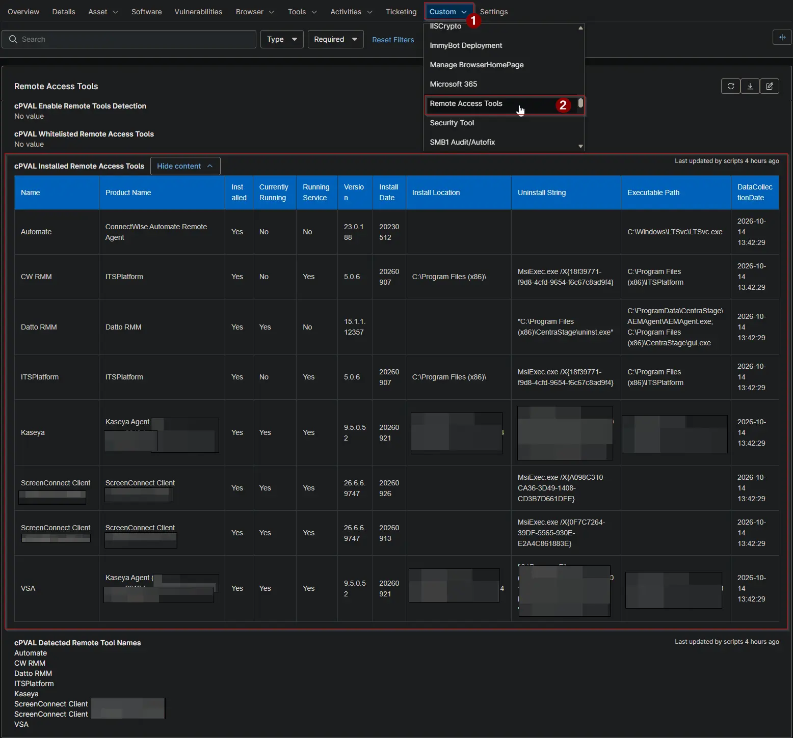

## Summary

Lists the remote access, RMM and other management tools detected on the device, such as TeamViewer, AnyDesk, ScreenConnect, Kaseya or Datto. Use it to find unapproved tools that give outside access to your devices. The [Installed Remote Tool Audits](/docs/8111fecc-61de-4c72-933c-b719351b7a1e) automation fills this field, and the [Admin - RMM or Other Management Software](/docs/68d77a2d-3fa9-4244-931b-e7eeb46962d7) report collects it from every client.

:::note  
When no tool is found, the table holds a single row named `No remote access tools detected` with `Installed` set to `No`.  
:::

## Details

| Label | Field Name | Example | Definition Scope | Type | Required | Default Value | Dropdown Options | Editable | Custom Field Tab |
| ----- | ---------- | ------- | ---------------- | ---- | -------- | ------------- | ---------------- | -------- | ---------------- |
| cPVAL Installed Remote Access Tools | cpvalInstalledRemoteAccessTools | HTML table | `Device` | `WYSIWYG` | `False` | - | - | `No` | Remote Access Tools |

## Table Columns

The field holds a table with one row per detected tool. Each ScreenConnect instance gets its own row.

| Column | Description |
| ------ | ----------- |
| Name | The tool name, or the name of the ScreenConnect instance. |
| Product Name | The installed product names found for the tool, separated by semicolons. |
| Installed | `Yes` when the tool was found. |
| Currently Running | `Yes` when the tool is running. |
| Running Service | `Yes` when the tool runs as an active Windows service. |
| Version | The installed version. |
| Install Date | The install date, as the installer recorded it. |
| Install Location | The installation folder. |
| Uninstall String | The command that removes the tool. |
| Executable Path | Where the tool program is located. |
| DataCollectionDate | When the data was collected. |

## Dependencies

* [Automation: Installed Remote Tool Audits](/docs/8111fecc-61de-4c72-933c-b719351b7a1e)
* [Audit Report: Admin - RMM or Other Management Software](/docs/68d77a2d-3fa9-4244-931b-e7eeb46962d7)
* [Solution: Installed Remote Access Tool Audit](/docs/eae2fab9-4697-4e1e-ad8f-93f8a09d7056)

## Custom Field Creation

- [Custom Field Configuration](https://github.com/ProVal-Tech/ninjarmm/blob/main/custom-fields/cpval-installed-remote-access-tools.toml)

## Sample Screenshot

## Changelog

### 2026-10-14

- Added the `Product Name` column and renamed `Script Ran Date` to `DataCollectionDate`.
- Added the Table Columns section and the [Admin - RMM or Other Management Software](/docs/68d77a2d-3fa9-4244-931b-e7eeb46962d7) report to the dependencies.
- Updated the Details table to the standard format.

### 2026-06-24

- Renamed the custom field to `cPVAL Installed Remote Access Tools` from `cPVAL RMM Audits`

### 2026-05-21

- Initial version of the document
