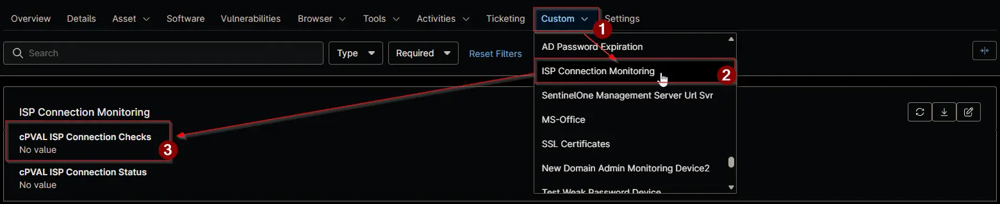

## Summary

Holds the ISP line checks that the [ISP Connection Monitoring](/docs/fad08ef4-122c-4df2-8cb3-aad1b285a473) solution runs on the device. Enter one check per line in the format `Name|URL|ExpectedText`:

- **Name** appears in the ticket, so name the ISP and the line, for example `Primary ISP Fibre Connection Monitor`. It can't contain `|` or `;`.
- **URL** is a public IP lookup site that the site's firewall routes out that ISP line. It must start with `http://` or `https://`.
- **ExpectedText** is the line's public IP, for example `203.0.113.10`, or the start of it, for example `203.0.113`.

A device is monitored only while this field holds a check. Clear the field to stop monitoring the device. The field is on the **ISP Connection Monitoring** tab of Windows devices.

## Details

| Label | Field Name | Example | Definition Scope | Type | Required | Default Value | Dropdown Options | Editable | Custom Field Tab |
| ----- | ---------- | ------- | ---------------- | ---- | -------- | ------------- | ---------------- | -------- | ---------------- |
| cPVAL ISP Connection Checks | cpvalIspConnectionChecks | `Primary ISP Connection Monitor\|https://myexternalip.com/raw\|203.0.113.10` | `Device` | Multi-line | No |  | | Yes | `ISP Connection Monitoring` |

## Dependencies

- [Automation: ISP Connection Monitor](/docs/64936e58-3cd2-4430-b40f-d9a2419786e2)
- [Compound Condition: ISP Connection Monitoring](/docs/9f23f871-6125-47ab-8a46-429893104702)
- [Solution: ISP Connection Monitoring](/docs/fad08ef4-122c-4df2-8cb3-aad1b285a473)

## Custom Field Creation

- [Custom Field Configuration](https://github.com/ProVal-Tech/ninjarmm/blob/main/custom-fields/cpval-isp-connection-checks.toml)

## Sample Screenshot

## Changelog

### 2026-11-06

- Initial version of the document
