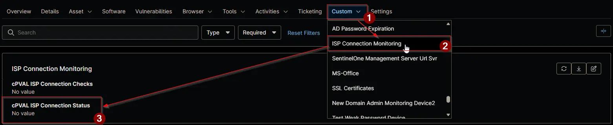

## Summary

Shows the result of the last [ISP Connection Monitor](/docs/64936e58-3cd2-4430-b40f-d9a2419786e2) run on the device. The automation overwrites the field each time it runs. The first line is `Last Checked:` followed by the device's local date and time in `yyyy-MM-dd HH:mm:ss` format. Next comes a `FAIL` line for each failed check, with the reason or the IP the lookup site returned, then a `PASS` line for each passed check, with the IP the lookup site returned.

The field is read-only for technicians. It isn't updated while [cPVAL ISP Connection Checks](/docs/48803081-ae39-4113-bb40-41c1c5dba610) is blank, so it keeps the last result after a device stops being monitored. The field is on the **ISP Connection Monitoring** tab of Windows devices.

## Details

| Label | Field Name | Example | Definition Scope | Type | Required | Default Value | Dropdown Options | Editable | Custom Field Tab |
| ----- | ---------- | ------- | ---------------- | ---- | -------- | ------------- | ---------------- | -------- | ---------------- |
| cPVAL ISP Connection Status | cpvalIspConnectionStatus | `Last Checked: 2026-01-15 09:30:00` | `Device` | Multi-line | No |  | | No | `ISP Connection Monitoring` |

## Dependencies

- [Automation: ISP Connection Monitor](/docs/64936e58-3cd2-4430-b40f-d9a2419786e2)
- [Solution: ISP Connection Monitoring](/docs/fad08ef4-122c-4df2-8cb3-aad1b285a473)

## Custom Field Creation

- [Custom Field Configuration](https://github.com/ProVal-Tech/ninjarmm/blob/main/custom-fields/cpval-isp-connection-status.toml)

## Sample Screenshot

## Changelog

### 2026-11-06

- Initial version of the document
