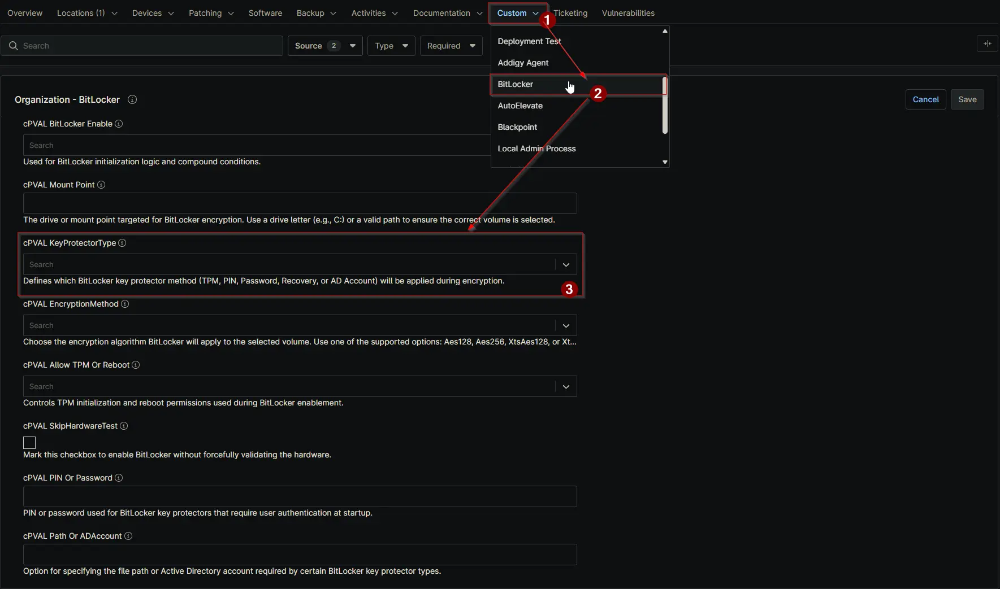

## Summary

Defines the BitLocker key protector the [BitLocker Initialize - NinjaOne](/docs/2ebfabd5-05cf-4175-a513-2aa290eb26e8) solution applies to the drive. When the field is blank, it uses `RecoveryPassword`.

| Key protector | Unlocks the system drive at startup with | Also needs |
| ------------- | ---------------------------------------- | ---------- |
| `Tpm` | The TPM | A ready TPM |
| `TpmPin` | The TPM and a PIN | A ready TPM and [cPVAL PIN Or Password](/docs/897971d9-4b4a-4554-8dd4-fc0bb324ed9b) |
| `TpmStartup` | The TPM and a startup key on a USB drive | A ready TPM and [cPVAL Path Or ADAccount](/docs/fb290c5b-cf73-4b7e-be34-ada7d3391e47) |
| `TpmPinStartup` | The TPM, a PIN and a startup key | A ready TPM, [cPVAL PIN Or Password](/docs/897971d9-4b4a-4554-8dd4-fc0bb324ed9b) and [cPVAL Path Or ADAccount](/docs/fb290c5b-cf73-4b7e-be34-ada7d3391e47) |
| `Password` | A password | [cPVAL PIN Or Password](/docs/897971d9-4b4a-4554-8dd4-fc0bb324ed9b) |
| `Startup` | A startup key on a USB drive | [cPVAL Path Or ADAccount](/docs/fb290c5b-cf73-4b7e-be34-ada7d3391e47) |
| `RecoveryPassword` | The TPM; the 48-digit recovery password is kept for recovery | A ready TPM on the system drive. [cPVAL PIN Or Password](/docs/897971d9-4b4a-4554-8dd4-fc0bb324ed9b) can set the recovery password. |
| `RecoveryKey` | The TPM; a recovery key file is saved for recovery | A ready TPM on the system drive and [cPVAL Path Or ADAccount](/docs/fb290c5b-cf73-4b7e-be34-ada7d3391e47) |
| `AdAccount` | The TPM; the Active Directory account or group can unlock the drive | A ready TPM on the system drive and [cPVAL Path Or ADAccount](/docs/fb290c5b-cf73-4b7e-be34-ada7d3391e47) |

:::note
`RecoveryPassword`, `RecoveryKey` and `AdAccount` cannot unlock the system drive at startup by themselves, so the solution always adds a TPM protector alongside them on that drive. A system drive that already has only one of them gets the TPM protector without being decrypted. When the device has no usable TPM, the system drive is left unchanged rather than protected in a way that asks for the recovery key at every startup. For devices without a TPM, use `Password` or `Startup`, which also need the group policy that allows BitLocker without a compatible TPM.
:::

:::note
Windows allows only one TPM based protector per drive. Switching a drive from one TPM based protector to another, for example from `Tpm` to `TpmPin`, makes the solution decrypt the drive and encrypt it again.
:::

## Details

| Label | Field Name | Example | Definition Scope | Type | Required | Default Value | Dropdown Options | Editable | Custom Field Tab |
| ----- | ---------- | ------- | ---------------- | ---- | -------- | ------------- | ---------------- | -------- | ---------------- |
| cPVAL KeyProtectorType | cpvalKeyprotectortype | `TpmPin` | `Organization`, `Location`, `Device` | `Drop-down` | `False` | `RecoveryPassword` | `Tpm`, `TpmPin`, `TpmStartup`, `TpmPinStartup`, `Password`, `Startup`, `RecoveryKey`, `RecoveryPassword`, `AdAccount` | `Yes` | BitLocker |

## Dependencies

- [Custom Field: cPVAL PIN Or Password](/docs/897971d9-4b4a-4554-8dd4-fc0bb324ed9b)
- [Custom Field: cPVAL Path Or ADAccount](/docs/fb290c5b-cf73-4b7e-be34-ada7d3391e47)
- [Automation: BitLocker Initialization - Detection](/docs/87d7a413-4bd4-4629-9475-35db91cb1320)
- [Automation: Initialize and Audit BitLocker](/docs/e3a24552-f347-4117-82f5-7afaaa3fc198)
- [Solution: BitLocker Initialize - NinjaOne](/docs/2ebfabd5-05cf-4175-a513-2aa290eb26e8)

## Custom Field Creation

- [Custom Field Configuration](https://github.com/ProVal-Tech/ninjarmm/blob/main/custom-fields/cpval-key-protector-type.toml)

## Sample Screenshot

## Changelog

### 2026-10-26

- Documented what each key protector needs and how the system drive unlocks at startup.
- Documented that `RecoveryPassword`, `RecoveryKey` and `AdAccount` get a TPM protector on the system drive and that the drive is left unchanged without a usable TPM.
- Updated the document to the standard format.

### 2025-12-16

- Initial version of the document
