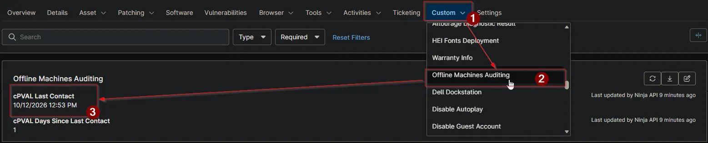

## Summary

Stores the UTC date and time a device last checked in to NinjaOne when its offline duration meets or exceeds the lowest threshold supplied to the [Offline Machines Report - Organization and Global KB](/docs/bae00191-7c86-4ceb-96a9-f34f05b5ec9f) automation.

Paired with [cPVAL Days Since Last Contact](/docs/c83d2b65-1f94-4e72-8a56-3b910d4e62c8), this field allows technicians to filter, group, and audit offline endpoints directly from NinjaOne device search and custom groups — including in environments where the NinjaOne Documentation (Knowledge Base) feature is not enabled.

The field is managed entirely through the NinjaOne Public API. During each run of the reporting automation, any reported workstation or server whose last contact is older than or equal to the lowest day threshold in `Threshold Days` has its last contact timestamp written to this field. If a device later checks back in — or if `Threshold Days` is raised so the device no longer meets the minimum threshold — the automation clears the field back to `null` on its next run.

## Details

| Label | Field Name | Example | Definition Scope | Type | Required | Default Value | Editable | Custom Field Tab |
| ----- | ---------- | ------- | ---------------- | ---- | -------- | ------------- | -------- | ---------------- |
| `cPVAL Last Contact` | `cpvalLastContact` | `2026-08-15 14:22:10` | `Device` | `Date/Time` | `No` | | `No` | `Offline Machines Auditing` |

## Dependencies

- [Custom Field: cPVAL Days Since Last Contact](/docs/c83d2b65-1f94-4e72-8a56-3b910d4e62c8)
- [Custom Field: cPVAL Ninja API Client ID](/docs/32142af2-d352-4d0d-9ec3-9dae0a5fef88)
- [Custom Field: cPVAL Ninja API Client Secret](/docs/58b01634-4e1a-4793-aafd-18526ea8c80e)
- [Automation: Offline Machines Report - Organization and Global KB](/docs/bae00191-7c86-4ceb-96a9-f34f05b5ec9f)
- [Solution: Offline Machines Reporting](/docs/ec53fd65-8cd1-4af6-9f78-b3fa97e54af1)

## Custom Field Creation

- [Custom Field Configuration](https://github.com/ProVal-Tech/ninjarmm/blob/main/custom-fields/cpval-last-contact.toml)

## Sample Screenshot

## Changelog

### 2026-10-14

- Initial version of the document
