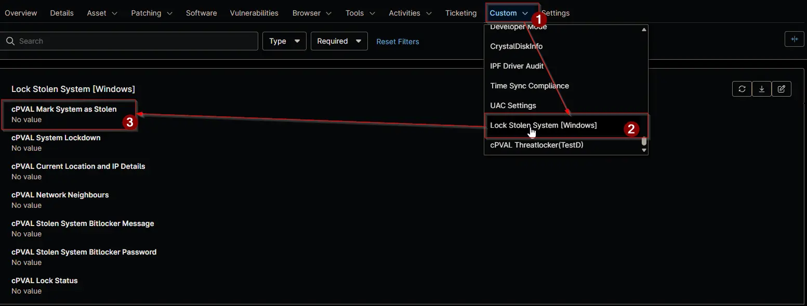

## Summary

Check this field to mark a device as lost or stolen. While it's checked, the [Lock Stolen System](/docs/13b4df99-df9b-4a57-bc0f-8675c68be028) solution records the device's location, IP and network details every time it's online and, if [cPVAL System Lockdown](/docs/4b18c9bf-8aea-41a5-8242-77dfcfd0042a) is also checked, locks the device down. Uncheck it once the device is recovered, before you run an unlock automation. The field is on the **Lock Stolen System [Windows]** tab of Windows devices and the **Lock Stolen System [Macintosh]** tab of Macs.

## Details

| Label | Field Name | Example | Definition Scope | Type | Required | Default Value | Dropdown Options | Editable | Custom Field Tab |
| ----- | ---------- | ------- | ---------------- | ---- | -------- | ------------- | ---------------- | -------- | ---------------- |
| cPVAL Mark System as Stolen | cpvalMarkSystemAsStolen | Checked | `Device` | Checkbox | No | Unchecked | | Yes | <ul><li>`Lock Stolen System [Windows]`</li><li>`Lock Stolen System [Macintosh]`</li></ul> |

## Dependencies

- [Automation: Lock Stolen System [Windows]](/docs/0f78be64-557a-4c0e-b7cf-e2ba41e71374)
- [Automation: Lock Stolen System [Macintosh]](/docs/08b38e83-0836-49de-b185-dbfc97a0f249)
- [Automation: Unlock Stolen System [Windows]](/docs/0ced6b64-58a6-4a7f-bfea-a40724f6b554)
- [Automation: Unlock Stolen System [Macintosh]](/docs/ef4a9833-6094-4e6e-ad99-12ae267db316)
- [Compound Condition: Lock Stolen Systems [Windows]](/docs/705b400b-28fc-4c01-95a6-edbf43960122)
- [Compound Condition: Lock Stolen Systems [Macintosh]](/docs/e2669c99-0a79-4456-9923-b63345bf9a3c)
- [Solution: Lock Stolen System](/docs/13b4df99-df9b-4a57-bc0f-8675c68be028)

## Custom Field Creation

- [Custom Field Configuration](https://github.com/ProVal-Tech/ninjarmm/blob/main/custom-fields/cpval-mark-system-as-stolen.toml)

## Sample Screenshot

## Changelog

### 2026-11-05

- Added the field to Mac devices on the Lock Stolen System [Macintosh] tab, moved it to the Lock Stolen System [Windows] tab on Windows devices, and updated the description for the Windows and Mac versions of the solution.

### 2026-02-10

- Initial version of the document
