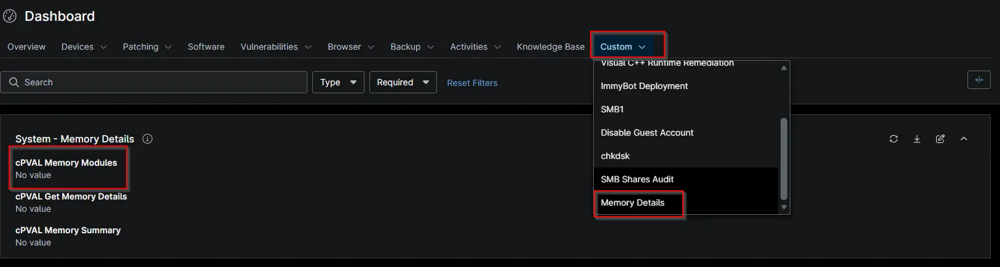

## Summary

Collects detailed physical memory module information from Windows endpoints using NinjaOne and stores the per-module inventory details in the cPVAL Memory Modules WYSIWYG custom field.

## Details

| Label | Field Name | Example | Definition Scope | Type | Required | Default Value | Dropdown Options | Editable | Custom Field Tab |
 ---- | ---- | ---- | ---- | ---- | ---- | ---- | ---- | ---- | ---- |
| cPVAL Memory Modules | cpvalMemoryModules | -- | `device` | `WYSIWYG` | True | -- | -- | True | Memory Details |

## Dependencies

- [Automation: Get Detailed Memory Information](/docs/36bad181-d46c-4c2a-a3b6-7c52800a5f76)
- [Solution: Get Detailed Memory Information - NinjaOne](/docs/fd8c41d3-ecf7-4eb8-95f5-4317a787a579)

## Custom Field Creation

- [Custom Field Configuration](https://github.com/ProVal-Tech/ninjarmm/blob/main/custom-fields/cpval-memory-modules.toml)

## Sample Screenshot

## Changelog

### 2026-10-29

- Initial version of the document
