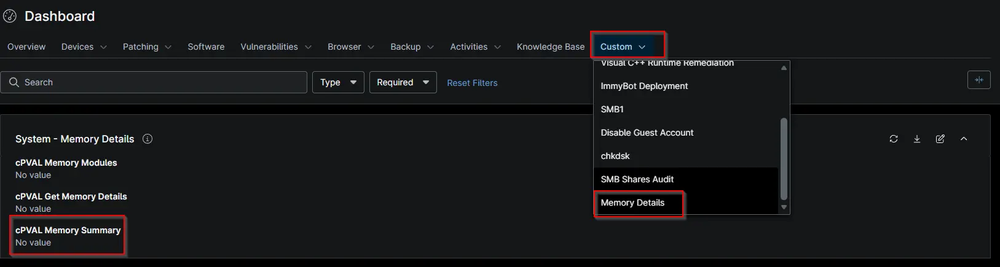

## Summary

Collects and displays a summary of physical memory information from Windows endpoints and stores the consolidated memory inventory details.

## Details

| Label | Field Name | Example | Definition Scope | Type | Required | Default Value | Dropdown Options | Editable | Custom Field Tab |
 ---- | ---- | ---- | ---- | ---- | ---- | ---- | ---- | ---- | ---- |
| cPVAL Memory Summary | cpvalMemorySummary | -- | `Device` | `WYSIWYG` | True | --- | -- | True | Memory Details |

## Dependencies

- [Automation: Get Detailed Memory Information](/docs/36bad181-d46c-4c2a-a3b6-7c52800a5f76)
- [Solution: Get Detailed Memory Information - NinjaOne](/docs/fd8c41d3-ecf7-4eb8-95f5-4317a787a579)

## Table Columns

| Column Name | Description |
| ----------- | ----------- |
| Organization | The organization the device belongs to. |
| Location | The location assigned to the device. |
| Device | The device name. |
| LastContact | The last contact time reported by NinjaOne. |
| LastUser | The last user associated with the device, as reported by NinjaOne. |
| DeviceType | The device type reported by NinjaOne. |
| OS | The operating system installed on the device. |
| OSBuild | The operating system build number. |
| Manufacturer | The device manufacturer. |
| Model | The device model. |
| Memory Summary | Consolidated memory information, including installed RAM, slot usage, maximum supported capacity, and potential upgrade options. |

## Custom Field Creation

- [Custom Field Configuration](https://github.com/ProVal-Tech/ninjarmm/blob/main/custom-fields/cpval-memory-summary.toml)

## Sample Screenshot

## Changelog

### 2026-11-02

- Initial version of the document
