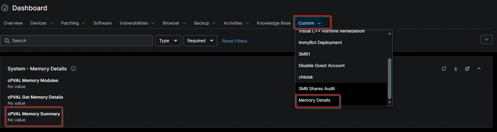

## Summary

## Details

| Label | Field Name | Example | Definition Scope | Type | Required | Default Value | Dropdown Options | Editable | Custom Field Tab |
| cPVAL Memory Summary | cpvalMemorySummary | -- | `Location`, `Organization`,`device`, `system` | `DropDown` | `WYSIWYG` | True | --- | -- | True | memory Details |

## Dependencies

- [Automation: Get Detailed Memory Information](/docs/36bad181-d46c-4c2a-a3b6-7c52800a5f76)
- [Solution: Get Detailed Memory Information](/docs/fd8c41d3-ecf7-4eb8-95f5-4317a787a579)

## Custom Field Creation

- [Custom Field Configuration](https://github.com/ProVal-Tech/ninjarmm/blob/main/custom-fields/cpval-memory-summary.toml)

## Sample Screenshot

## Changelog

### 2026-10-23

- Initial version of the document
