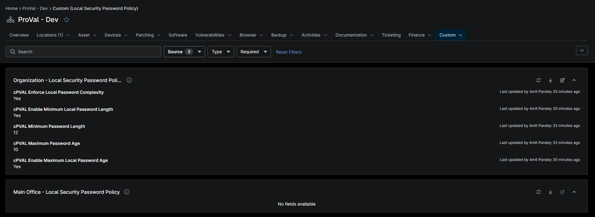

## Summary

Provide the minimum length for the local password length policy. The valid range is between 8 and 14.

## Details

| Label | Field Name | Example | Definition Scope | Type | Required | Default Value | Editable | Custom Field Tab |
| ----- | ---------- | ------- | ---------------- | ---- | -------- | ------------- | ---------------- | -------- |
| cPVAL Minimum Password Length | cpvalMinimumPasswordLength | True | `Organization` | Checkbox | True |  |  True | Local Security Password Policy |

## Dependencies

- [Solution: Get Detailed Memory Information](/docs/fd8c41d3-ecf7-4eb8-95f5-4317a787a579)
- [Compound Condition: Get Detailed Memory Information - Workstations](/docs/62d1b964-0aca-4406-bfd7-c6f446418029)
- [Compound Condition: Get Detailed Memory Information - Servers](/docs/3e5b56c4-7ac8-48ef-8332-ce6c683ff492)

## Custom Field Creation

- [Custom Field Configuration](https://github.com/ProVal-Tech/ninjarmm/blob/main/custom-fields/cpval-minimum-password-length.toml)

## Sample Screenshot

## Changelog

### 2026-10-07

- Initial version of the document