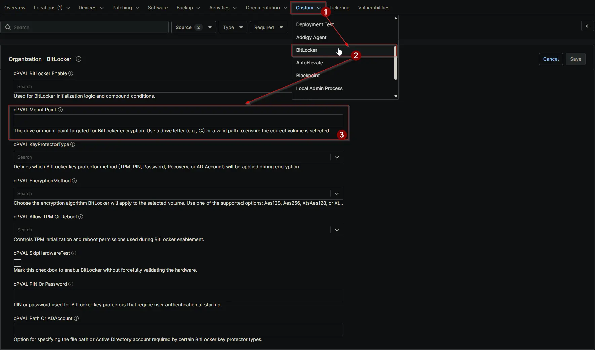

## Summary

The drive on which the [BitLocker Initialize - NinjaOne](/docs/2ebfabd5-05cf-4175-a513-2aa290eb26e8) solution enforces BitLocker. Enter a drive letter as `D`, `D:` or `D:\`. When the field is blank, the solution uses the system drive, usually `C:`. Any other value, such as a folder path, is ignored: the system drive is used instead, and the activity log shows a warning.

:::note
A data drive protected by a `RecoveryPassword`, `RecoveryKey` or `AdAccount` protector also gets auto-unlock, so it unlocks together with the system drive after a restart. Auto-unlock requires an encrypted system drive.
:::

## Details

| Label | Field Name | Example | Definition Scope | Type | Required | Default Value | Dropdown Options | Editable | Custom Field Tab |
| ----- | ---------- | ------- | ---------------- | ---- | -------- | ------------- | ---------------- | -------- | ---------------- |
| cPVAL MountPoint | cpvalMountpoint | `D:` | `Organization`, `Location`, `Device` | `Text` | `False` | System drive | - | `Yes` | BitLocker |

## Dependencies

- [Automation: BitLocker Initialization - Detection](/docs/87d7a413-4bd4-4629-9475-35db91cb1320)
- [Automation: Initialize and Audit BitLocker](/docs/e3a24552-f347-4117-82f5-7afaaa3fc198)
- [Solution: BitLocker Initialize - NinjaOne](/docs/2ebfabd5-05cf-4175-a513-2aa290eb26e8)

## Custom Field Creation

- [Custom Field Configuration](https://github.com/ProVal-Tech/ninjarmm/blob/main/custom-fields/cpval-mountpoint.toml)

## Sample Screenshot

## Changelog

### 2026-10-26

- Documented the accepted drive letter formats and that a path falls back to the system drive.
- Added the auto-unlock note for data drives.
- Updated the document to the standard format.

### 2025-12-16

- Initial version of the document
