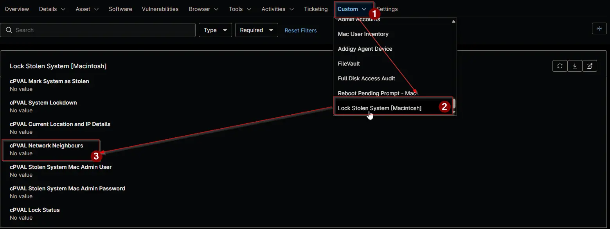

## Summary

Lists up to 30 devices found on the same local network as a stolen device, with their IP address, MAC address, network interface, DNS name and collection time (UTC). Windows computers also show each device's connection state. The [Lock Stolen System](/docs/13b4df99-df9b-4a57-bc0f-8675c68be028) solution fills it in each time the device is online. Names such as a router or printer name can help identify the network the device is using. The field is on the **Lock Stolen System [Windows]** tab of Windows devices and the **Lock Stolen System [Macintosh]** tab of Macs.

## Details

| Label | Field Name | Example | Definition Scope | Type | Required | Default Value | Dropdown Options | Editable | Custom Field Tab |
| ----- | ---------- | ------- | ---------------- | ---- | -------- | ------------- | ---------------- | -------- | ---------------- |
| cPVAL Network Neighbours | cpvalNetworkNeighbours | A table of nearby devices | `Device` | WYSIWYG | No |  | | Yes | <ul><li>`Lock Stolen System [Windows]`</li><li>`Lock Stolen System [Macintosh]`</li></ul> |

## Dependencies

- [Automation: Lock Stolen System [Windows]](/docs/0f78be64-557a-4c0e-b7cf-e2ba41e71374)
- [Automation: Lock Stolen System [Macintosh]](/docs/08b38e83-0836-49de-b185-dbfc97a0f249)
- [Solution: Lock Stolen System](/docs/13b4df99-df9b-4a57-bc0f-8675c68be028)

## Custom Field Creation

- [Custom Field Configuration](https://github.com/ProVal-Tech/ninjarmm/blob/main/custom-fields/cpval-network-neighbours.toml)

## Sample Screenshot

## Changelog

### 2026-11-05

- Added the field to Mac devices on the Lock Stolen System [Macintosh] tab and moved it to the Lock Stolen System [Windows] tab on Windows devices. The table now lists up to 30 devices, including devices without a DNS name, and shows the network interface of each.

### 2026-02-25

- Initial version of the document
