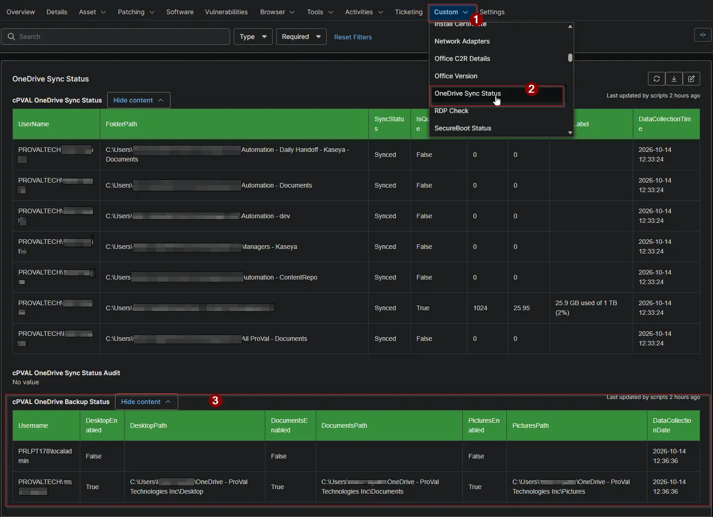

## Summary

Shows, for every user on the device, whether the Desktop, Documents and Pictures folders are backed up to OneDrive. Use it to find users whose files would be lost if the device failed. The [Get OneDrive Backup Status](/docs/6d7374c8-a485-4748-89d9-02f913514ab9) automation fills this field, and the [OneDrive Backup Status](/docs/a15225e6-a949-475d-9e26-8b527d9db505) report collects it from every client.

:::note  
Every user profile on the device gets a row, including users who are not signed in and users without OneDrive.  
:::

## Details

| Label | Field Name | Example | Definition Scope | Type | Required | Default Value | Dropdown Options | Editable | Custom Field Tab |
| ----- | ---------- | ------- | ---------------- | ---- | -------- | ------------- | ---------------- | -------- | ---------------- |
| cPVAL OneDrive Backup Status | cpvalOnedriveBackupStatus | HTML table | `Device` | `WYSIWYG` | `False` | - | - | `Yes` | OneDrive Sync Status |

## Table Columns

The field holds a table with one row per user profile.

| Column | Description |
| ------ | ----------- |
| Username | The user, as `DOMAIN\user`. |
| DesktopEnabled | `True` when the Desktop folder is backed up to OneDrive. |
| DesktopPath | Where the Desktop folder is stored. Blank when it is not backed up. |
| DocumentsEnabled | `True` when the Documents folder is backed up to OneDrive. |
| DocumentsPath | Where the Documents folder is stored. Blank when it is not backed up. |
| PicturesEnabled | `True` when the Pictures folder is backed up to OneDrive. |
| PicturesPath | Where the Pictures folder is stored. Blank when it is not backed up. |
| DataCollectionDate | When the data was collected. |

## Dependencies

* [Automation: Get OneDrive Backup Status](/docs/6d7374c8-a485-4748-89d9-02f913514ab9)
* [Audit Report: OneDrive Backup Status](/docs/a15225e6-a949-475d-9e26-8b527d9db505)
* [Solution: Get OneDrive Backup Status](/docs/67648c92-1636-419d-a541-e5a7f496fc85)

## Custom Field Creation

- [Custom Field Configuration](https://github.com/ProVal-Tech/ninjarmm/blob/main/custom-fields/cpval-onedrive-backup-status.toml)

## Sample Screenshot

## Changelog

### 2026-10-14

- Initial version of the document
