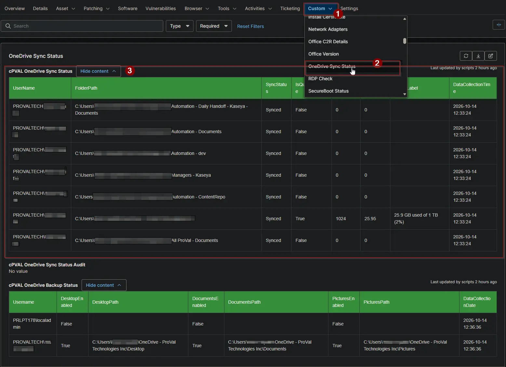

## Summary

Shows the OneDrive sync status and storage quota of the user signed in to the device. Use it to find users whose files are not syncing or whose OneDrive is nearly full. The [Get OneDrive Sync Status](/docs/29e62bb2-d641-472d-a92b-11404471b915) automation fills this field, and the [OneDrive Sync Status](/docs/497eb371-29a6-4049-b96d-6d19f3e5cb09) report collects it from every client.

:::note  
The field is only updated while a user is signed in and OneDrive is running.  
:::

## Details

| Label | Field Name | Example | Definition Scope | Type | Required | Default Value | Dropdown Options | Editable | Custom Field Tab |
| ----- | ---------- | ------- | ---------------- | ---- | -------- | ------------- | ---------------- | -------- | ---------------- |
| cPVAL OneDrive Sync Status | cpvalOnedriveSyncStatus | HTML table | `Device` | `WYSIWYG` | `False` | - | - | `Yes` | OneDrive Sync Status |

## Table Columns

The field holds a table with one row per OneDrive account of the signed-in user.

| Column | Description |
| ------ | ----------- |
| UserName | The user whose OneDrive was checked. |
| FolderPath | The local OneDrive folder. |
| SyncStatus | The sync state, for example `UpToDate`, `Syncing` or `Error`. |
| IsQuotaAvailable | `True` when OneDrive reported storage quota information. |
| TotalQuota | The total OneDrive storage, in GB. |
| UsedQuota | The OneDrive storage in use, in GB. |
| QuotaLabel | The storage state reported by OneDrive. |
| DataCollectionTime | When the data was collected. |

## Dependencies

* [Automation: Get OneDrive Sync Status](/docs/29e62bb2-d641-472d-a92b-11404471b915)
* [Audit Report: OneDrive Sync Status](/docs/497eb371-29a6-4049-b96d-6d19f3e5cb09)
* [Solution: Get OneDrive Sync Status](/docs/22d8abe0-2ea4-48e9-8b02-6108cd2de889)

## Custom Field Creation

- [Custom Field Configuration](https://github.com/ProVal-Tech/ninjarmm/blob/main/custom-fields/cpval-onedrive-sync-status.toml)

## Sample Screenshot

## Changelog

### 2026-10-14

- Added the Table Columns section and the [OneDrive Sync Status](/docs/497eb371-29a6-4049-b96d-6d19f3e5cb09) report to the dependencies.
- Updated the Details table to the standard format.

### 2026-02-19

- Initial version of the document
