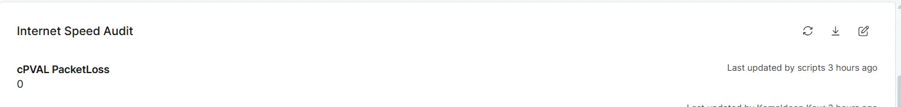

## Summary
Represents the packet loss detected on the device during an internet speed test. This custom field is updated by the [Automation - Internet Speed - Audit](/docs/5d4e181e-6fc8-4dfb-ad53-e8aae1a784a0).

## Details

| Label | Field Name | Example | Definition Scope | Type | Required | Default Value | Dropdown Options | Editable | Custom Field Tab |
| ----- | ---------- | ------- | ---------------- | ---- | -------- | ------------- | ---------------- | -------- | ---------------- |
| cPVAL PacketLoss | cpvalPacketloss | - | `Device` | Text | False | - | - | `Yes` | Internet Speed Audit |

## Dependencies

* [Automation - Internet Speed - Audit](/docs/5d4e181e-6fc8-4dfb-ad53-e8aae1a784a0)
* [Solution - Internet Speed Audit](/docs/7dc8d18c-aab4-4ad1-80bc-4e7beef98530)

## Custom Field Creation

- [Custom Field Configuration](https://github.com/ProVal-Tech/ninjarmm/blob/main/custom-fields/cpval-packetloss.toml)

## Sample Screenshot

## Changelog

### 2026-10-28

- Initial version of the document
