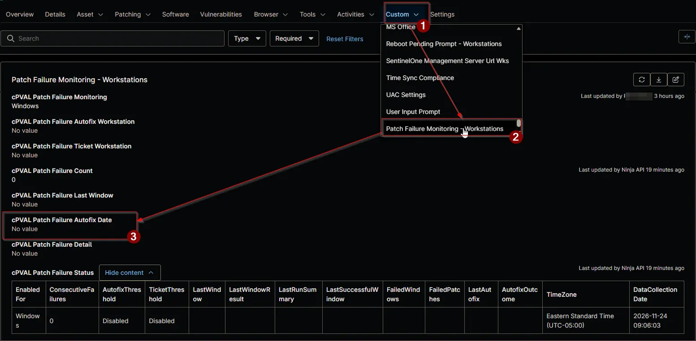

## Summary

Shows when [Patch Failure Monitoring - Detection](/docs/97aa8bfb-f376-4acf-8241-782c364d3d18) last requested [Repair Windows Update](/docs/d7bb77e6-e7b8-45d2-9fa7-f109574aa887) on the device. The detection script writes it right before the autofix compound condition runs the repair, and doesn't request another repair until a later patch window fails. The [Patch Failure Monitoring](/docs/28302386-1560-4468-be5c-c9d683b99e65) automation shows it in [cPVAL Patch Failure Status](/docs/6d0d7b7c-f71d-4db9-9767-e3b7cd4846cd) as LastAutofix, together with its outcome, and the ticket includes it.

:::note

- It's cleared when a successful patch window resets [cPVAL Patch Failure Count](/docs/02b8e35f-c8dd-4685-a00b-412fd0112c7c), and when the device is no longer monitored. [cPVAL Patch Failure Status](/docs/6d0d7b7c-f71d-4db9-9767-e3b7cd4846cd) keeps the last repair and its outcome.
- The field is script-managed and read only for technicians.

:::

## Details

| Label | Field Name | Example | Definition Scope | Type | Required | Default Value | Dropdown Options | Editable | Custom Field Tab |
| ----- | ---------- | ------- | ---------------- | ---- | -------- | ------------- | ---------------- | -------- | ---------------- |
| cPVAL Patch Failure Autofix Date | cpvalPatchFailureAutofixDate | `2026-11-23 07:12` | `Device` | Date/Time | No | |  | No | <ul><li>`Patch Failure Monitoring - Servers`</li><li>`Patch Failure Monitoring - Workstations`</li></ul> |

## Dependencies

- [Automation: Patch Failure Monitoring - Detection](/docs/97aa8bfb-f376-4acf-8241-782c364d3d18)
- [Automation: Patch Failure Monitoring](/docs/28302386-1560-4468-be5c-c9d683b99e65)
- [Automation: Repair Windows Update](/docs/d7bb77e6-e7b8-45d2-9fa7-f109574aa887)
- [Compound Condition: Patch Failure Monitoring - Autofix [Windows Servers]](/docs/ae7d3fd7-d4b4-4e0e-88a4-ed917a5dd402)
- [Compound Condition: Patch Failure Monitoring - Autofix [Windows Workstations]](/docs/6da0c83e-d6bd-4b4a-985b-6b7b6b2d7774)
- [Solution: Patch Failure Monitoring - NinjaOne](/docs/020ff3c5-06a6-4f98-9eaa-7f7392b2257a)

## Custom Field Creation

- [Custom Field Configuration](https://github.com/ProVal-Tech/ninjarmm/blob/main/custom-fields/cpval-patch-failure-autofix-date.toml)

## Sample Screenshot

## Changelog

### 2026-11-23

- Initial version of the document
