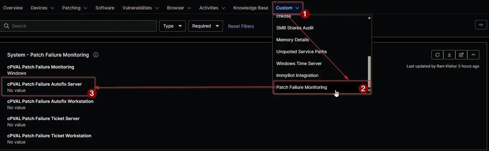

## Summary

Sets the number of consecutive failed patch windows at which servers get [Repair Windows Update](/docs/d7bb77e6-e7b8-45d2-9fa7-f109574aa887) automatically. When [cPVAL Patch Failure Count](/docs/02b8e35f-c8dd-4685-a00b-412fd0112c7c) reaches this number, the [Patch Failure Monitoring - Autofix [Windows Servers]](/docs/ae7d3fd7-d4b4-4e0e-88a4-ed917a5dd402) compound condition runs the repair once per failed patch window, until the count reaches the ticket threshold in [cPVAL Patch Failure Ticket Server](/docs/3c54b72d-8fb2-49bd-a2a2-5c6b08833b12).

| Value | Result |
| ----- | ------ |
| Blank | Inherits from the level above. Blank at every level means no repair. |
| `0` | No repair at this level, even if a level above sets a threshold. |
| `1` or more | The repair runs once the count reaches this number. For example, `1` repairs the device after its first failed patch window. |

:::note

- The field applies to servers only and is ignored on workstations.
- The repair runs [Repair Windows Update](/docs/d7bb77e6-e7b8-45d2-9fa7-f109574aa887) with no options. It resets the Windows Update components and scans for updates again, without SFC, DISM or a restart.
- A change takes effect at the next check of the autofix compound condition, within an hour.

:::

## Details

| Label | Field Name | Example | Definition Scope | Type | Required | Default Value | Dropdown Options | Editable | Custom Field Tab |
| ----- | ---------- | ------- | ---------------- | ---- | -------- | ------------- | ---------------- | -------- | ---------------- |
| cPVAL Patch Failure Autofix Server | cpvalPatchFailureAutofixServer | `1` | `System`, `Organization`, `Location`, `Device` | Integer | No | |  | Yes | <ul><li>`Patch Failure Monitoring` (System)</li><li>`Patch Failure Monitoring` (Organization and Location)</li><li>`Patch Failure Monitoring - Servers`</li></ul> |

## Dependencies

- [Automation: Patch Failure Monitoring - Detection](/docs/97aa8bfb-f376-4acf-8241-782c364d3d18)
- [Automation: Repair Windows Update](/docs/d7bb77e6-e7b8-45d2-9fa7-f109574aa887)
- [Compound Condition: Patch Failure Monitoring - Autofix [Windows Servers]](/docs/ae7d3fd7-d4b4-4e0e-88a4-ed917a5dd402)
- [Custom Field: cPVAL Patch Failure Ticket Server](/docs/3c54b72d-8fb2-49bd-a2a2-5c6b08833b12)
- [Solution: Patch Failure Monitoring - NinjaOne](/docs/020ff3c5-06a6-4f98-9eaa-7f7392b2257a)

## Custom Field Creation

- [Custom Field Configuration](https://github.com/ProVal-Tech/ninjarmm/blob/main/custom-fields/cpval-patch-failure-autofix-server.toml)

## Sample Screenshot

## Changelog

### 2026-11-23

- Initial version of the document
