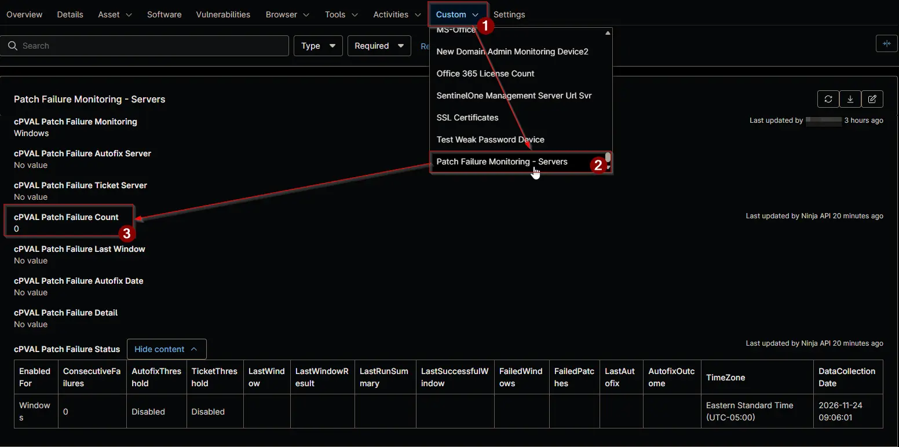

## Summary

Shows the number of consecutive NinjaOne patch windows in which an update with a KB number failed on the device. The [Patch Failure Monitoring](/docs/28302386-1560-4468-be5c-c9d683b99e65) automation updates it once a day, and the autofix and ticket compound conditions compare it with the thresholds.

- A failed patch window adds 1.
- A successful patch window resets it to `0`.
- A patch window in which nothing needed installing doesn't change it.
- Counting starts when the device is first monitored, from the patch windows of the last 24 hours.

:::note

- Only OS patch runs started by NinjaOne count, and only updates with a KB number. See [Patch Failure Monitoring - NinjaOne](/docs/020ff3c5-06a6-4f98-9eaa-7f7392b2257a) for how patch windows are counted.
- It's cleared when the device is no longer monitored.
- The field is script-managed and read only for technicians.

:::

## Details

| Label | Field Name | Example | Definition Scope | Type | Required | Default Value | Dropdown Options | Editable | Custom Field Tab |
| ----- | ---------- | ------- | ---------------- | ---- | -------- | ------------- | ---------------- | -------- | ---------------- |
| cPVAL Patch Failure Count | cpvalPatchFailureCount | `2` | `Device` | Integer | No | |  | No | <ul><li>`Patch Failure Monitoring - Servers`</li><li>`Patch Failure Monitoring - Workstations`</li></ul> |

## Dependencies

- [Automation: Patch Failure Monitoring](/docs/28302386-1560-4468-be5c-c9d683b99e65)
- [Automation: Patch Failure Monitoring - Detection](/docs/97aa8bfb-f376-4acf-8241-782c364d3d18)
- [Custom Field: cPVAL Patch Failure Last Window](/docs/5b700551-2f69-4ac2-9489-bfa279c8d7ac)
- [Custom Field: cPVAL Patch Failure Detail](/docs/b23a6da2-148f-4649-9233-c02170b5e72f)
- [Solution: Patch Failure Monitoring - NinjaOne](/docs/020ff3c5-06a6-4f98-9eaa-7f7392b2257a)

## Custom Field Creation

- [Custom Field Configuration](https://github.com/ProVal-Tech/ninjarmm/blob/main/custom-fields/cpval-patch-failure-count.toml)

## Sample Screenshot

## Changelog

### 2026-11-23

- Initial version of the document
