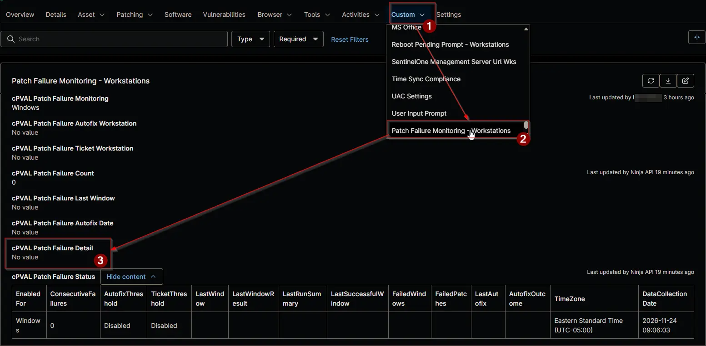

## Summary

Lists the failed patch windows of the current run of failures, one line per window, with the start of the window, its time zone and the KB number and name of each failed update. The [Patch Failure Monitoring](/docs/28302386-1560-4468-be5c-c9d683b99e65) automation writes it once a day, and [Patch Failure Monitoring - Detection](/docs/97aa8bfb-f376-4acf-8241-782c364d3d18) adds it to the ticket.

- It keeps the last 10 failed patch windows.
- The times are in the time zone of the primary machine that runs [Patch Failure Monitoring](/docs/28302386-1560-4468-be5c-c9d683b99e65), which each line shows.
- When NinjaOne reports failed updates without naming them, the line shows how many failed. For the latest window, it also lists the approved updates still not installed on the device, which usually include the failed ones.

:::note

- It's cleared when a successful patch window resets [cPVAL Patch Failure Count](/docs/02b8e35f-c8dd-4685-a00b-412fd0112c7c), and when the device is no longer monitored.
- The field is script-managed and read only for technicians.

:::

## Details

| Label | Field Name | Example | Definition Scope | Type | Required | Default Value | Dropdown Options | Editable | Custom Field Tab |
| ----- | ---------- | ------- | ---------------- | ---- | -------- | ------------- | ---------------- | -------- | ---------------- |
| cPVAL Patch Failure Detail | cpvalPatchFailureDetail | `Failed window 2026-11-23 02:05:12 Eastern Standard Time (UTC-05:00): KB5068787 (2026-11 Cumulative Update for Microsoft server operating system version 24H2 for x64-based Systems)` | `Device` | Multi-line | No | |  | No | <ul><li>`Patch Failure Monitoring - Servers`</li><li>`Patch Failure Monitoring - Workstations`</li></ul> |

## Dependencies

- [Automation: Patch Failure Monitoring](/docs/28302386-1560-4468-be5c-c9d683b99e65)
- [Automation: Patch Failure Monitoring - Detection](/docs/97aa8bfb-f376-4acf-8241-782c364d3d18)
- [Compound Condition: Patch Failure Monitoring - Ticket [Windows Servers]](/docs/fafe75cc-3caa-4713-9f78-507ad9eec3b5)
- [Compound Condition: Patch Failure Monitoring - Ticket [Windows Workstations]](/docs/d4488df1-2292-4886-ab7a-46207ec6f856)
- [Ticket Template: Consecutive Patch Failures](/docs/d5aaffa6-061b-4349-86f3-cf30b9a3cd14)
- [Solution: Patch Failure Monitoring - NinjaOne](/docs/020ff3c5-06a6-4f98-9eaa-7f7392b2257a)

## Custom Field Creation

- [Custom Field Configuration](https://github.com/ProVal-Tech/ninjarmm/blob/main/custom-fields/cpval-patch-failure-detail.toml)

## Sample Screenshot

## Changelog

### 2026-11-23

- Initial version of the document
